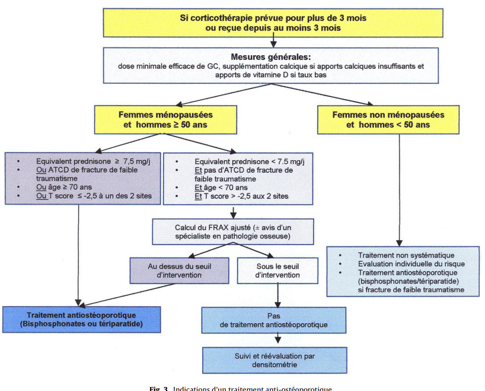
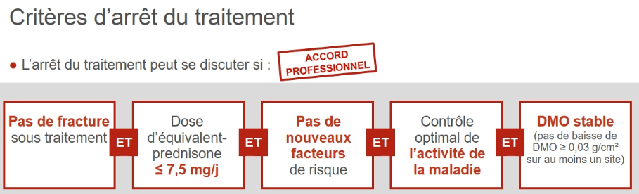
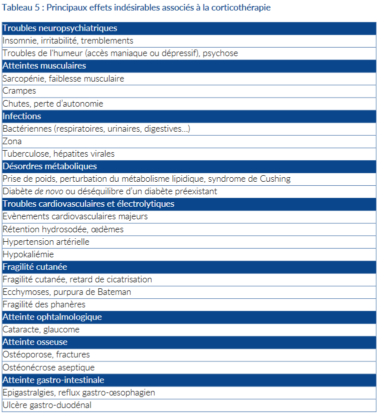

# **Bilan à l'initiation d'une probable corticothérapie prolongée**

## Prévention de l'ostéoporose cortico-induite

- La meilleure mesure préventive = dose minimale efficace le moins longtemps possible
  - Envisager tous les moyens d'épargne cortisonique : injections intra-articulaires, voie inhalée
  - Envisager un traitement de fond
- Évaluation du risque fracturaire :
  - Ostéodensitométrie = obligatoire et remboursée pour toute corticothérapie > 7,5 mg pendant plus de 3 mois
    - Mais chez les adultes jeunes < 50 ans elle est souvent insuffisante pour prédire le risque de fracture
    - Donc il ne faudra pas oublier le reste ci-dessous
  - Facteurs de risque :
    - ! Le plus important = fractures personnelles ostéoporotiques !
      - Interrogatoire
      - Dépistage des fractures vertébrales :
        - perte d'au moins 4 cm par rapport à la taille de 20 ans
        - perte d'au moins 2 cm pendant le suivi
    - ATCD de fracture de fragilité du col fémoral chez un parent du premier degré
    - Tabagisme, alcoolisme
    - Ménopause précoce (< 40 ans)
    - Immobilisation prolongée
    - IMC < 19
    - Endocrinopathie : hyperthyroïdie, hyperparathyroïdie, orchidectomie, ovariectomie, hypercorticisme
    - Médicaments : corticothérapie au long cours, diurétiques hypercalciuriants (de l'anse), anti-œstrogène, anti-androgène, anti-aromatase
    - Risque de chute
- Dosage de la vitamine D, objectif 30 ng/mL = 75 nmol/L
- Éliminer les autres ostéopathies fragilisantes (bilan bio)
- Questionnaire des apports calciques GRIO : apports calciques suffisants (800-1200 mg par jour soit 4 produits laitiers)
- Traitements :
  - Bisphosphonates
  - Tériparatide en 1ère intention si entre dans l'AMM (2 fractures vertébrales) car marche mieux
- Durée de traitement
  - 2 ans pour les bisphosphonates et 18 mois pour le tériparatide
  - Sauf si fracture à faible cinétique ou DMO basse : dans ce cas 3 à 5 ans comme d'habitude
  - Dans tous les cas il faut réévaluer la nécessité de poursuite du traitement à l'issue de la première séquence thérapeutique avec un rhumatologue
- Ostéodensitométrie dans le suivi
  - Tous les ans si pas de traitement
  - Après la fin d'une séquence thérapeutique sinon

## Prévention des complications cardiovasculaires et du diabète

- Antécédents personnels et familiaux
- Facteurs de risque cardiovasculaires : poids, IMC, tension, glycémie à jeun, HbA1c, bilan lipidique, tabagisme
- ECG (si FDR cardiovasculaires)
- SCORE 2
- Correction de ces FDR

## Prévention des complications infectieuses

- Recherche de foyer infectieux
- Vaccination grippe, pneumocoque, ZONA (SHINGRIX), mise à jour du calendrier vaccinal
- ! Contre-indication aux vaccins vivants atténués si dose > 10 mg/j = BCG, fièvre jaune…
- IGRA si contact avec tuberculose non ou insuffisamment traitée
- Sérologies hépatiques
- Radiographie pulmonaire
- Traitement antiparasitaire pour tout patient ayant séjourné dans une zone endémique d'anguillulose maligne = régions tropicales et subtropicales, certaines zones d'Europe du Sud, notamment au Portugal

## Prévention des complications digestives

- Antécédent d'ulcère ?
- ATCD hépatiques ?

## Prévention des complications psychiatriques

- ATCD psychiatriques ?

## Éducation thérapeutique

- Conseils concernant l'activité physique
- Conseils diététiques : restriction d'apports en sucres rapides, limitation du sel, apports protidiques et calciques suffisants
- +/- consultation diététique
- Arrêt du tabagisme

