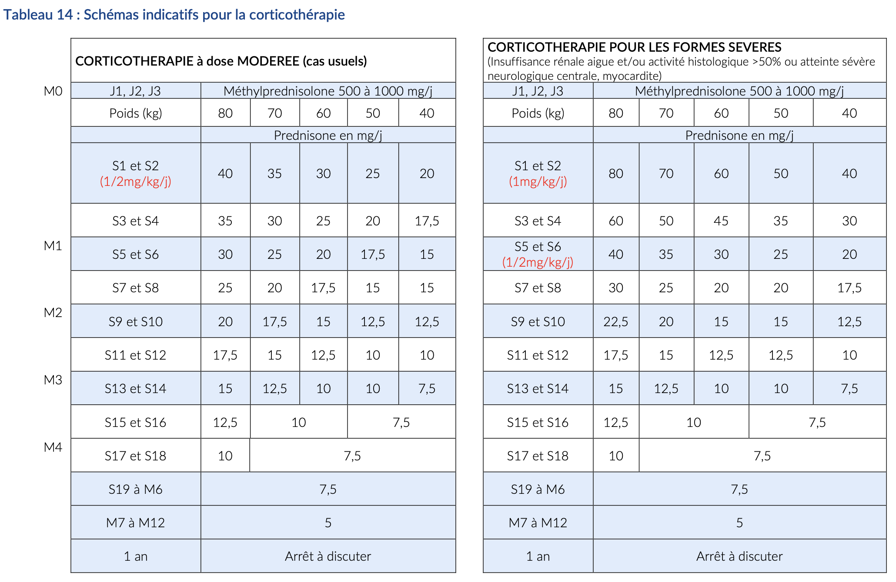
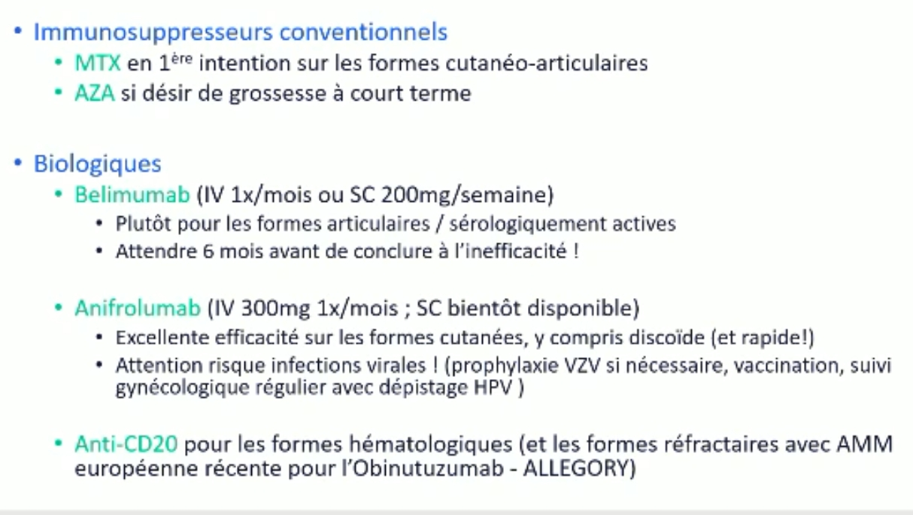

# Lupus

# Epidémio
Maladie rare
9 femmes pour 1 homme 
période d'activité ovarienne (max entre 30 et 39 ans)
# Interrogatoire
### Contexte
- Antécédents personnels et/ou familiaux de maladies auto-immunes ou de déficits immunitaires
- Antécédents de manifestations cliniques compatibles avec un LS et/ou un SAPL
- Prise de médicaments potentiellement inducteurs
### Symptomes généraux
* Fièvre
* Asthénie • Anorexie • Amaigrissement
* Fatigue 
# Clinique
### Cutané 
Photosensibilité
Éruption des zones photo-exposées : 
- Lupus aigu
- Lupus subaigu
- Lupus discoïde
Ulcérations buccales 
### Articulaire
Arthralgies inflammatoires, ± arthrites
=> polyarthrite ou arthralgies
### Sérites
### Atteinte rénale
Protéinurie
### Atteinte hématologique
Cytopénie(s)
Adénomégalie et hépatosplénomégalie
### Hypocomplémentémie 
Diminution du CH50, des fractions C3 et C4
### Atteinte neurologique
### SAPL
# Paraclinique
## Biologie 
### Dissociation VS/CRP
élévation de la VS alors que la CRP reste normale
### Anomalies de l'hémogramme
Anémie : 
* Centrale normocytaire :
  * Myélogramme +/- BOM
* Hémolytique auto-immune :
  * Frottis sanguin à la recherche de schizocytes
  * Test direct à l’antiglobuline (= test de Coombs direct)
  * Haptoglobine, LDH, bilirubine libre
Lymphopénie 
Neutropénie 
Thrombopénie
Syndrome d'Evans = Thrombopénie, anémie hémolytique ± leuconeutropénie auto-immunes
### Anticorps 
* Antinucléaires (ou anti-noyaux) => sensibles mais peu spécifiques
* Anti-ADN natif => spécifiques mais moins sensibles
* Anti ENA :
  * Anti-Sm
  * Anti-Ro60/SSA, et anti-La/SSB 
  * Anti-RNP
* SAPL = antiphospholipides : 
  - anticoagulant circulant
  - anticardiolipine
  - anti-bêta2-glycoprotéine de type I (β2GPI)
* D’autres anticorps peuvent être retrouvés au cours du lupus mais ne sont pas à rechercher de façon systématique : anti-nucléosomes, anti-protéines P ribosomales, anti-ku, anti-C1q.
* FR
### Hypocomplémentémie
La présence d’une « hypocomplémentémie » est un argument en faveur du diagnostic de LS mais : 
* Les baisses du CH50 et du C4 sont très sensibles et peu spécifiques.
* Seule la baisse du C3 est un biomarqueur plus spécifique du LS. 
### Recherche d'atteinte rénale
* Recherche de protéinurie, leucocyturie, hématurie
* Créatinine sérique
### Bilan cardiovasculaire 
EAL
Glycémie à jeun 
### Autres examens biologiques 
* Électrophorèse des protéines sériques
* ASAT, ALAT, gamma GT, Phosphatases alcalines, bilirubine, amylase, lipase
* Diagnostic différentiel :
  * Sérologies VIH, VHC, parvovirus B19 pour l’exclusion d’une infection virale simulant
parfois initialement un LS
  * Anticorps antiprotéines citrulinées (anti-CCP)
  * Selon la symptomatologie, autres auto-anticorps : anti-mitochondries, anti-LKM, anti-
actine, anticytoplasme des polynucléaires (liste non exhaustive).
* Examens selon les manifestations :
  * CPK
  * Les anticorps anti-AQP4 et anti-MOG doivent être recherchés en urgence en cas de myélite
et/ou de névrite optique.
  * Une cryoglobulinémie et une immunoglobuline monoclonale doivent être recherchées en cas de mononeuropathie simple ou multiple.
* Examens en fonction du contexte clinique et des options thérapeutiques
envisagées :
  * Ionogramme sanguin, glycémie, albuminémie
  * Électrophorèse des protéines plasmatiques
  * Calcémie – phosphorémie
  * CPK
  * TP, TCA
  * Dosage des IgA sériques : recherche d’un déficit associé
  * Recherche d’un déficit en fractions C1q, C1r, C1s, C2 du complément dans les LS avec
activité effondrée du CH50 persistante pendant les périodes prolongées de rémission
  * Test de grossesse
  * Avant instauration d’une corticothérapie à dose immunosuppressive, d’un
immunosuppresseur ou d’une biothérapie : sérologie VIH, hépatite C et B (AgHBs, AcHBs
et Ac HBc) et radiographie de thorax

## Biopsie cutanée 
Pas systématique. 
Uniquement si doute sur des lésions. 
Notamment en cas de purpura pour éliminer des diagnostics différentiels (SAPL vs vascularite)
## Radiologie
### Radiographies 
* Articulaires => normales => à faire pour éliminer diag différentiels
* Thorax de face + profil 
### Echographie
Pour donner des arguments au diagnostic (synovites, tenosynovites)
### Ostéodensitométrie 
Si 3 mois de corticos ou autres facteurs de risques (remboursée uniquement si > 3 mois > 7.5mg/j)
## Autres examens complémentaires 
### Bilan ophtalmologique 
Lors de la mise sous HCQ, ce bilan pouvant être fait dans les mois
suivant la mise en route du traitement. 
=> Examen ophtalmologique, champ visuel central automatisé 10° et OCT-SD.
### ECG
### echographie trans-thoracique de référence 
### IPS et écho-doppler artériel de référence
### Scanner thoracique 
En cas de suspicion d'atteinte respiratoire ou radio anormale. 
## Biopsie rénale 
### Indiquée en cas : 
* de protéinurie ≥ 0.5g/g ou 0.05 g/mmol sur échantillon ou 0.5g/24h
* une protéinurie persistante (en l’absence d’une infection urinaire associée ou des menstruations) à des taux inférieurs à ces seuils
* une insuffisance rénale inexpliquée.
### Interprétation : 
-   Escalade thérapeutique : **classes III(A)/IV(A)** (prolifératives actives, focales ou diffuses) et **III(A)/IV(A) + V** (même valeur péjorative).
  
-   Pas d'escalade :
    * classes I–II (mésangiales, pronostic favorable
    * III(C)/IV(C) pures (lésions chroniques séquellaires — attention : chronicité élevée = risque d'IRC).
-   Hors glomérule :
    * tubulo-interstitiel = valeur pronostique, rarement traité agressivement
    * vasculaire lupique avec vascularite = même valeur qu'une lésion active (escalade)
    * vasculaire thrombotique = traiter l'entité associée (SAPL, SHU atypique, HTA maligne), pas le lupus.

# Diagnostic
## Critères EULAR/ACR 2019 - Lupus Systémique

**Critère d'entrée obligatoire** : ANA ≥ 1/80 (HEp2 ou équivalent)

**Règles** : 
- Ne pas compter comme critère, si une autre explication que le LS est plus probable
- Une seule occurrence du critère est suffisante pour qu’il soit comptabilisé
- Il n’est pas nécessaire que les critères soient présents simultanément
- Pour chaque domaine c’est le critère au score le plus élevé qui est comptabilisé

| Domaine | Critère | Points |
|---------|---------|--------|
| Constitutionnel | Fièvre | 2 |
| Hématologique | Leucopénie | 3 |
| Hématologique | Thrombopénie | 4 |
| Hématologique | Hémolyse auto-immune | 4 |
| Neuro-psychiatrique | Délire | 2 |
| Neuro-psychiatrique | Psychose | 3 |
| Neuro-psychiatrique | Convulsions | 5 |
| Cutanéo-muqueux | Alopécie non cicatricielle | 2 |
| Cutanéo-muqueux | Érosion buccale | 2 |
| Cutanéo-muqueux | Lupus discoïde/sous-aigu | 4 |
| Cutanéo-muqueux | Lupus aigu | 6 |
| Sérites | Épanchement pleural/péricardique | 5 |
| Sérites | Péricardite aiguë | 6 |
| Articulaire | Atteinte articulaire | 6 |
| Rénal | Protéinurie > 0,5 g/24h | 4 |
| Rénal | Glomérulonéphrite classe II/V | 8 |
| Rénal | Glomérulonéphrite classe III/IV | 10 |
| Immunologique | aCL / anti-β2GP1 / anticoagulant circulant | 2 |
| Immunologique | C3 bas **ou** C4 bas | 3 |
| Immunologique | C3 bas **et** C4 bas | 4 |
| Immunologique | Anti-ADN natif **ou** anti-Sm | 6 |

**Classification LS** : ≥ 1 critère clinique **+ score total ≥ 10** (Se 96 % / Sp 93 %)
## SAPL
Toute positivité doit être confirmée par un nouveau dosage à 12 semaines d'intervalle.

**Critères de classification ACR EULAR 2023 du SAPL**
*(D'après Barbhaiya et al. Ann Rheum Dis ; Oct 2023)*

| Domaines | Levels | Score |
|---|---|---|
| **Cliniques** | | |
| 1 : Macrovasculaire, maladie thrombo-embolique veineuse | MTEV provoquée | 1 |
| | MTEV non provoquée | 3 |
| 2 : Macrovasculaire, thrombose artérielle | TA avec FDR CV majeurs | 2 |
| | TA sans FDR CV majeurs | 4 |
| 3 : Atteinte microvasculaire | Suspectée | 2 |
| | Confirmée | 5 |
| 4 : Manifestations obstétricales | ≥ 3 fausses couches spontanées (< 10 sem) ou perte fœtale | 1 |
| | Prééclampsie (PEC) sévère ou insuffisance placentaire sévère (< 34 sem) avec ou sans perte fœtale | 3 |
| | PEC sévère et insuffisance placentaire sévère (< 34 sem) avec ou sans perte fœtale | 4 |
| 5 : Atteinte valvulaire cardiaque | Épaississement valvulaire | 2 |
| | Végétation | 4 |
| 6 : Manifestation hématologique | Thrombocytopénie (20-130 G/L) | 2 |
| **Biologiques** | | |
| 7 : Lupus Anticoagulant | Présent à une seule reprise | 1 |
| | Positif persistant | 5 |
| 8 : ELISA Anticardiolipine et Anti-β2-Glycoprotéine-I IgG/M ELISA (persistant) | (IgM seule, concentration moyenne ou élevée) (aCL et/ou aβ2GPI) | 1 |
| | Concentration moyenne (IgG) (aCL ou aβ2GPI) | 4 |
| | Concentration élevée (IgG) (aCL ou aβ2GPI) | 5 |
| | Concentration élevée (IgG) (aCL et aβ2GPI) | 7 |

**Classification selon le score**
- **Score total** : ne compter que le critère avec la plus haute pondération dans chaque domaine (0-34)
- **Score requis pour la classification** : au moins 3 points dans les domaines cliniques et 3 points dans les domaines biologiques

# Traitement
## Traitement médicamenteux
### Traitement de crise 
**Prednisone :** 
* Bolus initiaux 500 à 1000mg par jour de methylprednisolone
* Relai per os avec dose initiale  :
  * 0.5 mg/Kg la plupart du temps
  * 1mg/Kg sans dépasser 60 à 80mg par jour selon le poids si :
    * patients afro-américains
    * Atteinte rénale : 
      * présence de croissants glomérulaires
      * insuffisance rénale aigue
      * activité histologique > 50%
    * atteinte sévère neurologique centrale ou myocardique
* Objectifs de la décroissance :
  * 7,5 mg de la semaine 19 à M6
  * 5mg de M6 à M12
  * Arrêt à discuter à M12
 
  
**AINS :**
* PAS ibuprofène car risque de méningite aseptique
* L’utilisation des AINS en cas d’atteinte rénale, neurologique ou vasculaire est
déconseillée.

### Traitement de fond

**Hydroxychloroquine pour tout le monde :**
* 5-6,5mg/kg
* En général ça fait 300mg
  * => 1 cp de 200mg jours impairs et 2 cps jours pairs
  * => ou 2 comprimés par jour
* Adapter à fonction rénale ou hépatique
* Son délai d’efficacité sur les signes articulaires est de 2 à 12 semaines.
* Effets secondaires :
  * Digestifs transitoires : ttt symptomatique
  * Allergie cutanée rare => cs allergo
  * Retinopathie
  * "Jambes de plaquenil" = purpura
  * Cardiopathie => ECG Si lipothymies

**+ MTX hors AMM :** 
* Indications :
  * en cas d'inefficacité de l'HCQ seule sur les manifestations articulaires
  * d'emblée si polyarthralgie invalidante
  * si corticodépendance
* 15-25 mg par semaine

**MFM :**
* Efficacité articulaire non démontrée 

**Inhibiteurs des calcineurines** (ciclosporine et tacrolimus)
**Biothérapies**
* **Belimumab**
* **Anifrolumab**
* **Rituximab ou Abatacept** si Rhupus
### Traitement des manifestations cutanées

## Mesures associées
* Stop tabac (moins de poussées et meilleure efficacité du tttt)
* Photoprotection (comme en population générale)
* Exercice physique **pour lutter contre la fatigue et l'ostéoporose**
* Prévention de l'ostéoporose cortico-induite :
  * Supplémentation vitaminocalcique
  * Pas de traitement spécifique < 50 ans en général (sauf gros facteurs de risque ou #)
* Prévention infectieuse (pneumocoque +/- zona selon ttts)
* Aspirine en prévention primaire si triple positif des ac SAPL
* Orthèses et rééducation de la main de Jaccoud
* Contraception si traitement de fond tératogène (pilule microprogestative ; COP possible si pas de complication cardiovasc du lupus ou FDR thromboemboliques)
 
 

# Objectif
## Faible activité (_Lupus Low Disease Activity State_)
* **SLEDAI :**
  * Score SLEDAI-2K ≤ 4
  * Pas d'activité dans les systèmes d'organes majeurs (rein, système nerveux central, cœur, vascularite et fièvre)
  * Pas anémie hémolytique ni activité gastro-intestinale
* **Prednisone ≤ 7,5 mg/j**
* **PGA (physician general assessment)  ≤ 1** (sur une échelle visuelle analogique de 0 à 3)
## Rémission
* **SLEDAI = 0**
* **Prednisone ≤ 5 mg/j**
* **PGA (physician global assessment) < 0,5** (sur une échelle visuelle analogique de 0 à 3)
## Score PGA 
|     |     |
| --- | --- |
| Disease Status | PGA |
| 0   | no activity |
| 1   | mild |
| 2   | moderate |
| 3   | severe |
# Suivi
**Recherche de protéinurie :**
* BU ou RAC à chaque poussée et tous les 3-6 mois en systématique
* Si positif : confirmer par un second prélèvement puis PBR diagnostique

**1 examen ophtalmologique de base** puis un tous les 5 ans après 5 ans de ttt

**Dosage sanguin du taux d'HCQ**
=> Inobservance si dosage < 200ng/ml (dosage non remboursé en ville => forfait hôpital)
=> Augmentation du risque de rechute < 750 ng/ml

# Grossesse
Circonstances déconseillant temporairement ou définitivement la planification d’une grossesse : 
* poussée lupique récente 
* corticodépendance (> 10 mg/j)
* débit de filtration glomérulaire < 40 mL/min/1,73m²
* HTA sévère
* hypertension pulmonaire imparfaitement contrôlée
* valvulopathie mal tolérée.

=> **Maladie en rémission depuis 6 mois (1 an si maladie rénale)**

Stop MTX 

