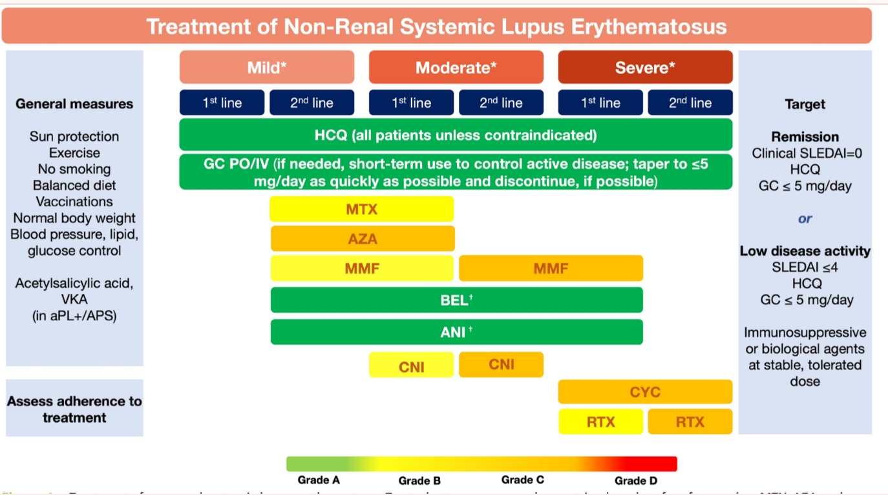
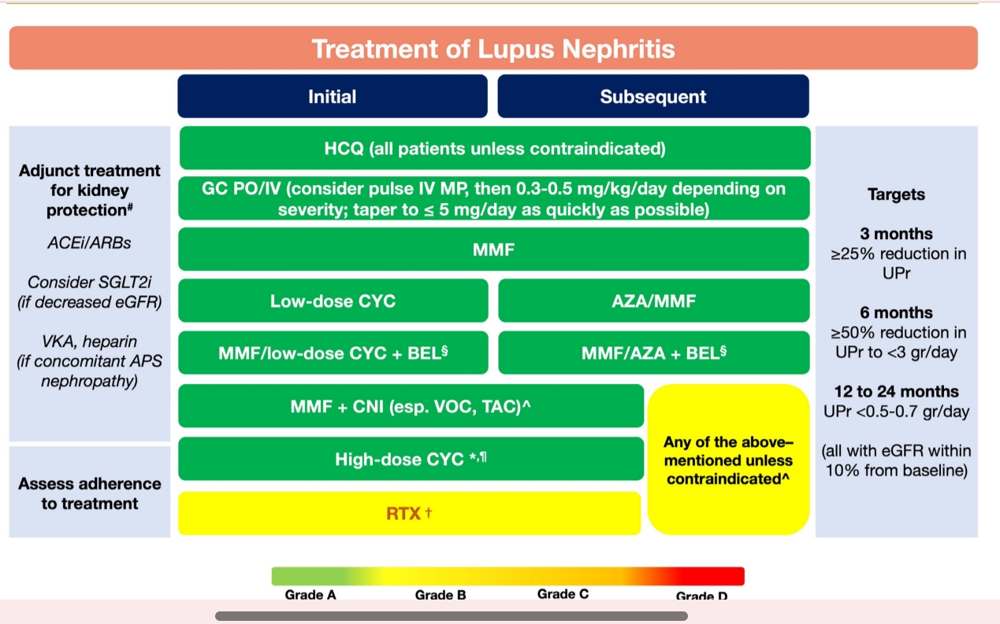

# Epidémio
Maladie rare
9 femmes pour 1 homme 
période d'activité ovarienne (max entre 30 et 39 ans)
# Interrogatoire
### Contexte
- Antécédents personnels et/ou familiaux de maladies auto-immunes ou de déficits immunitaires
- Antécédents de manifestations cliniques compatibles avec un LS et/ou un SAPL
- Prise de médicaments potentiellement inducteurs
### Symptomes généraux
* Fièvre
* Asthénie • Anorexie • Amaigrissement
# Clinique
### Cutané 
Photosensibilité
Éruption des zones photo-exposées : 
- Lupus aigu
- Lupus subaigu
- Lupus discoïde
Ulcérations buccales 
### Articulaire
Arthralgies inflammatoires, ± arthrites
=> polyarthrite ou arthralgies
### Sérites
### Atteinte rénale
Protéinurie
### Atteinte hématologique
Cytopénie(s)
Adénomégalie et hépatosplénomégalie
### Hypocomplémentémie 
Diminution du CH50, des fractions C3 et C4
### Atteinte neurologique
### SAPL
# Paraclinique
## Biologie 
### Dissociation VS/CRP
élévation de la VS alors que la CRP reste normale
### Anticorps 
* Antinucléaires (ou anti-noyaux)
* Anti-ADN natif
* Anti-Sm
* SAPL = antiphospholipides : 
  - anticoagulant circulant
  - anticardiolipine
  - anti-bêta2-glycoprotéine de type I (β2GPI)
* FR

# Diagnostic
## Critères EULAR/ACR 2019 - Lupus Systémique

**Critère d'entrée obligatoire** : ANA ≥ 1/80 (HEp2 ou équivalent)

**Règles** : 
- Ne pas compter comme critère, si une autre explication que le LS est plus probable
- Une seule occurrence du critère est suffisante pour qu’il soit comptabilisé
- Il n’est pas nécessaire que les critères soient présents simultanément
- Pour chaque domaine c’est le critère au score le plus élevé qui est comptabilisé

| Domaine | Critère | Points |
|---------|---------|--------|
| Constitutionnel | Fièvre | 2 |
| Hématologique | Leucopénie | 3 |
| Hématologique | Thrombopénie | 4 |
| Hématologique | Hémolyse auto-immune | 4 |
| Neuro-psychiatrique | Délire | 2 |
| Neuro-psychiatrique | Psychose | 3 |
| Neuro-psychiatrique | Convulsions | 5 |
| Cutanéo-muqueux | Alopécie non cicatricielle | 2 |
| Cutanéo-muqueux | Érosion buccale | 2 |
| Cutanéo-muqueux | Lupus discoïde/sous-aigu | 4 |
| Cutanéo-muqueux | Lupus aigu | 6 |
| Sérites | Épanchement pleural/péricardique | 5 |
| Sérites | Péricardite aiguë | 6 |
| Articulaire | Atteinte articulaire | 6 |
| Rénal | Protéinurie > 0,5 g/24h | 4 |
| Rénal | Glomérulonéphrite classe II/V | 8 |
| Rénal | Glomérulonéphrite classe III/IV | 10 |
| Immunologique | aCL / anti-β2GP1 / anticoagulant circulant | 2 |
| Immunologique | C3 bas **ou** C4 bas | 3 |
| Immunologique | C3 bas **et** C4 bas | 4 |
| Immunologique | Anti-ADN natif **ou** anti-Sm | 6 |

**Classification LS** : ≥ 1 critère clinique **+ score total ≥ 10** (Se 96 % / Sp 93 %)
## SAPL
Toute positivité doit être confirmée par un nouveau dosage à 12 semaines d'intervalle.

# Traitement
**Traitement de crise :**
Prednisone
AINS (PAS ibuprofen car risque de méningite aseptique)

**Traitement de fond**
Hydroxychloroquine pour tout le monde : 
* 5-6,5mg/kg
* En général ça fait 300mg => 1 cp jours impairs et 2 cps jours pairs
* Effets secondaires :
  * Digestifs transitoires : ttt symptomatique
  * Allergie cutanée rare => cs allergo
  * Retinopathie
  * "Jambes de plaquenil" = purpura
  * Cardiopathie => ECG Si lipothymies

MTX
MFM
Inhibiteurs des calcineurines (ciclosporine et tacrolimus)
Belimumab
Anifrolumab
 
**Mesures associées**
* Stop tabac (moins de poussées et meilleure efficacité du tttt)
* Photo protection (comme en population générale)
* Exercice physique
* Prévention infectieuse (pneumocoque +/- zona selon ttts)
* Aspirine en prévention primaire si triple positif des ac SAPL

 
 

# Objectif
SLEDAI < 5
CTC < 7.5mg/j
PGA (physician general assessment) < 1 
= LLDAS 
# Suivi
**Recherche de protéinurie :**
* BU ou RAC à chaque poussée et tous les 3-6 mois en systématique
* Si positif : confirmer par un second prélèvement puis PBR diagnostique

**1 examen ophtalmologique de base** puis un tous les 5 ans après 5 ans de ttt

**Observance :**
  => dosage HCQ > 200ng/ml sinon inobservance (dosage non remboursé en ville => forfait hôpital)

# Grossesse

Pas contre indiqué
Mais maladie en rémission depuis 6 mois (1 an si maladie rénale)
Stop MTX 

