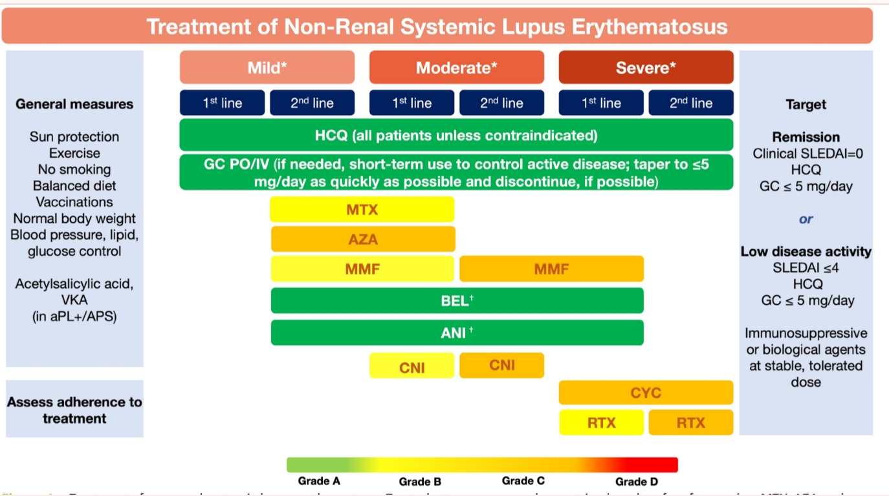
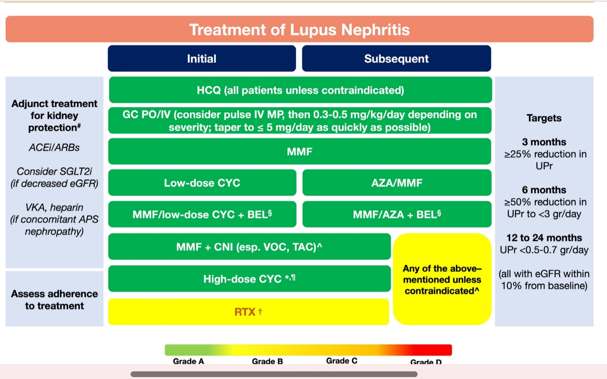
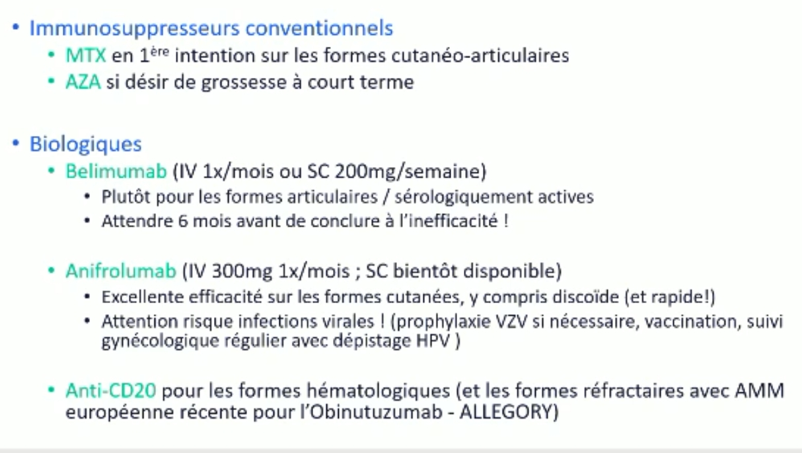

# Lupus systémique — v2 (PNDS 2024)

*Fiche de cours. Base identique à « Lupus » ; contenu enrichi du PNDS « Lupus systémique de l'adulte et de l'enfant » (HAS, janvier 2024). Orientation prise en charge rhumatologique : les atteintes d'organe non rhumatologiques ne sont détaillées que pour l'évaluation diagnostique initiale et le repérage.*

---

# Définition — Épidémiologie

- Maladie systémique **protéiforme**, chronique, évoluant **par poussées**, d'expression et de gravité variables selon les organes atteints.
- Rupture de tolérance immunitaire → auto-Ac dirigés contre les constituants des corps apoptotiques (nucléosome, ADN, histones, RNP, phospholipides) ; complexes immuns, activation de la voie classique du complément (C1q) et de la voie des interférons de type I (IFN-I) et **BLyS** (cibles thérapeutiques).
- **90 % de femmes**, pic de prévalence entre **30 et 39 ans**. Incidence 3–4/100 000/an, prévalence ≈ 41/100 000 en France ; **surprévalence aux Antilles** (94/100 000 en Guadeloupe, 127/100 000 en Martinique).
- Forme **pédiatrique** = diagnostic < 16 ans : rare (2 % des cas prévalents), **plus grave**, atteinte rénale plus fréquente.
- **ALD 21**. Le **lupus cutané isolé** (« pur », peau/muqueuses/phanères) n'entre **pas** dans l'ALD 21.
- Facteurs d'environnement : **UV**, œstrogènes, **tabac**, silice, virus Epstein-Barr, certains médicaments (→ lupus médicamenteux, régressif à l'arrêt) ; 10 % de formes familiales.
- **Pronostic vital** : atteintes viscérales sévères (rénale ++), **risque infectieux**, complications cardiovasculaires.
- S'associe parfois au **SAPL** (thromboses ± événements obstétricaux + aPL persistants à 12 semaines).

# Évaluation initiale & diagnostic

Le diagnostic est **clinico-biologique** (faisceau d'arguments), il n'y a pas de critère diagnostic unique. Annonce structurée type EPICES ; ne pas retarder l'annonce devant un faisceau suffisant.

## Critères de classification EULAR/ACR 2019

⚠️ Critères de **classification** (études cliniques), **pas diagnostiques** : excellente sensibilité (96 %), spécificité moindre (93 %).

**Critère d'entrée obligatoire** : AAN ≥ 1/80 sur cellules **HEp-2** (ou test équivalent).

Règles de comptage : pour chaque domaine seul le **critère au score le plus élevé** compte ; une seule occurrence suffit ; ne pas compter un critère si une autre explication est plus probable ; pas besoin de simultanéité.

| Domaine | Critère (score) |
| :--- | :--- |
| Constitutionnel | Fièvre (2) |
| Hématologique | Leucopénie (3) · Thrombopénie (4) · Hémolyse auto-immune (4) |
| Neuro-psychiatrique | Délire (2) · Psychose (3) · Convulsions (5) |
| Cutanéo-muqueux | Alopécie non cicatricielle (2) · Érosion buccale (2) · Lupus discoïde ou subaigu (4) · Lupus aigu (6) |
| Sérites | Épanchement pleural ou péricardique (5) · Péricardite aiguë (6) |
| Articulaire | Atteinte articulaire (6) |
| Rénal | Protéinurie > 0,5 g/24 h (4) · GN lupique classe II ou V (8) · GN lupique classe III ou IV (10) |
| Immunologique | ACC ou anticardiolipine ou anti-β2GP1 (2) · **C3 ou** C4 bas (3) · **C3 et** C4 bas (4) · anti-ADN natif **ou** anti-Sm (6) |

→ **LS classé si : ≥ 1 critère clinique ET score total ≥ 10.** (Anciens systèmes conservés en annexe du PNDS : ACR 1997 — 4/11 critères ; SLICC 2012 — 4 critères dont ≥ 1 clinique et 1 biologique.)

## Repérage des atteintes (tous organes)

Fréquence des manifestations lupiques sur 1000 patients (Cervera 1993) :

| Manifestation | Initialement | Pendant le suivi |
| :--- | :--- | :--- |
| Éruption malaire (vespertilio) | 40 % | 58 % |
| Photosensibilité | 29 % | 45 % |
| Ulcérations buccales | 11 % | 24 % |
| **Polyarthrite** | **69 %** | **84 %** |
| Sérite | 17 % | 36 % |
| Atteinte rénale | 15 % | **40 %** |
| Atteinte neurologique | 12 % | 27 % |
| Thrombopénie | 9 % | 22 % |
| Anémie hémolytique | 4 % | 8 % |
| Atteinte pulmonaire | 3 % | 7 % |

**Systémique** : fièvre, asthénie, anorexie, amaigrissement, adénopathies/splénomégalie. La **fatigue** concerne ~80 % des patients (la traiter = contrôler l'activité + éliminer les autres causes : dysthyroïdie, anémie, myopathie cortico-induite, insuffisance corticotrope, SAS, dépression, arrêt du traitement de fond).

**Cutanéo-muqueux** — les lésions **spécifiques** sont un argument diagnostique majeur :
- **Aigu** (vespertilio, lésions érosives buccales) : atteinte systémique constante.
- **Subaigu** : annulaire/psoriasiforme, moitié supérieure du corps, **anti-SSA/Ro** (7–21 % des LS) ; penser au **lupus médicamenteux inducteur** (pénicillines, doxycycline, IC, IEC/ARA2, IS, biothérapies, IPP, statines, inhibiteurs de check-points…).
- **Chronique** (cicatriciel) : **lupus discoïde** (10–20 %, jusqu'à 40–50 % sur phototypes foncés ; alopécie cicatricielle définitive, atteinte palmo-plantaire érosive très douloureuse), lupus engelure, **panniculite lupique**, lupus tumidus.
- **Non spécifiques et à connaître** : alopécie diffuse non cicatricielle ; lésions **thrombotiques** (livedo ramifié, purpura nécrotique, micro-infarctus, hémorragies sous-unguéales en flammèches) → **chercher un SAPL** ; lésions **neutrophiliques** (lupus bulleux, dermatose neutrophilique urticarienne, vascularite hypocomplémentémique de Mac Duffie) → implications thérapeutiques.

**Ostéo-articulaire** : > 80 %, souvent inaugurales → section dédiée.

**Rénal** : 30–40 % des adultes, souvent dans les premières années ou inaugural ; **souvent pauci-symptomatique**. HTA et/ou œdèmes des membres inférieurs → recherche de protéinurie. Seuils d'alerte : protéinurie des 24 h ≥ 0,5 g/j ou ratio protéinurie/créatininurie ≥ 0,5 g/g, ou protéinurie **persistante** en dessous de ces seuils → avis spécialisé + **PBR** (l'hématurie peut manquer).

**Neuro-psychiatrique** (SNC, SNP, autonome, psychiatrique) : convulsions, psychose, délire, mononévrite multiple, atteinte des paires crâniennes, myélite, neuropathie périphérique, syndrome confusionnel aigu. **Aucun auto-Ac spécifique** ; les marqueurs classiques d'activité ne sont pas corrélés. À éliminer systématiquement : cause infectieuse (dont abcès cérébral, LEMP, lymphome), métabolique, médicamenteuse. **Anti-AQP4 et anti-MOG en urgence si myélite et/ou névrite optique** ; cryoglobulinémie + Ig monoclonale si neuropathie périphérique.

**Cardiaque et vasculaire** : péricardite (++), myocardite, endocardite de **Libman-Sacks**, valvulopathies, thrombus — ECG et échocardiographie de référence ; maladie athéromateuse précoce.

**Respiratoire** : pleurésie, PINS / pneumopathie organisée / pneumopathie interstitielle lymphocytaire, hémorragie alvéolaire, HTAP, syndrome des poumons rétractés.

**Hématologique** : anémie (hémolytique, test de Coombs), leucopénie/lymphopénie, thrombopénie ; SAM, PTT (ADAMTS13) selon le tableau.

**Hépato-GE**, **ophtalmo/ORL**.

**Maladies associées à rechercher** : thyroïdite auto-immune (Hashimoto), **maladie de Sjögren** (syndrome sec, 15–30 %), **SAPL**.

## Bilan initial

**Auto-immunité** :
- **AAN** par IFI sur HEp-2 : examen de référence ; un titre < 1/80 rend le LS très improbable (bon test de dépistage, peu spécifique).
- **Anti-ADN double brin (natif), isotype G** : peu souvent positifs mais **très spécifiques**. Ordre de spécificité décroissante : test de **Farr** (référence) > IFI sur *Crithidia luciliæ* > méthodes immunologiques quantitatives. Confirmer par Farr/Crithidia si positivité faible et tableau clinique discutable. L'**absence** d'anti-ADN n'exclut pas le LS.
- **Anti-ENA** : anti-**Sm** (peu fréquents, **hautement spécifiques**), anti-Ro60/SSA et anti-La/SSB (Sjögren, lupus subaigu, **lupus néonatal**), anti-U1-RNP (connectivite mixte).
- **aPL** : **ACC lupique**, anticardiolipine IgG/IgM, anti-β2GP1 IgG/IgM (titres moyens à élevés ; persistance nécessaire à 12 semaines pour un SAPL).
- **Complément** : CH50, **C3**, C4. La baisse isolée du **C3** est la plus spécifique du LS (surtout associée aux atteintes rénales prolifératives) ; baisses de CH50 et C4 sensibles mais peu spécifiques ; de nombreuses poussées, parfois sévères, se font **sans** activation du complément. CH50 effondré avec C3/C4 normaux → chercher un déficit génétique en fractions précoces du complément.
- Non systématiques : anti-nucléosomes, anti-protéines P ribosomales, anti-C1q, anti-ku. **Sans valeur diagnostique** : anti-PCNA, anti-DFS70 isolés, anti-ADN dénaturé (simple brin), anti-ADN natif IgM.

**Autres** : hémogramme + réticulocytes, protéinurie / leucocyturie / hématurie + créatininémie, EPS, test de Coombs direct. La **CRP est le plus souvent normale** (élévation = infection, atteinte des séreuses, SAM).

**Diagnostic différentiel** : sérologies VIH, VHC, parvovirus B19 ; **anti-CCP** (vs PR).

**Avant traitement** : NFS, ionogramme, glycémie, bilan hépatique et lipidique, calcémie-phosphorémie, CPK, TP/TCA, IgA (déficit associé), sérologies **VIH/VHB/VHC** + radiographie de thorax avant corticothérapie immunosuppressive, IS ou biothérapie ; **ECG** ; **bilan ophtalmologique** lors de la mise sous HCQ ; test de grossesse ; TPMT avant azathioprine.

# Manifestations ostéo-articulaires

**Arthralgies et arthrites** (plus de 80 % des cas, volontiers inaugurales)
- *Arthralgies* : vives, à rythme **inflammatoire**, polyarticulaires et symétriques (mains, poignets), souvent associées à des myalgies ; la racine des membres est rarement touchée ; rachialgies plutôt fonctionnelles/myalgiques.
- Caractéristiques : **discordance marquée** entre l'intensité des douleurs et les signes objectifs ; **caractère fugace** (une articulation peut se normaliser en quelques heures) ; ténosynovites (fléchisseurs des doigts), tendinites et enthésites — identifiables à l'**échographie**, y compris à un stade pré-clinique ; **non destructeur et non déformant**.
- **Rhumatisme de Jaccoud** : atteinte des structures péri-articulaires → subluxations des MCP, déviation ulnaire, laxité, **déformations réductibles** (signe sémiologique clé) ; n'évolue pas vers l'érosion.
- **Rhupus** : polyarthrites sévères et érosives associées à des **ACPA/anti-CCP** → thérapeutique adaptée.
- **Monoarthrite = complication infectieuse jusqu'à preuve du contraire.**
- Piège : acrosyndrome marqué (syndrome de Raynaud) avec doigts boudinés peut mimer une polyarthrite œdémateuse — l'échec du traitement articulaire spécifique doit faire évoquer une atteinte **vasculaire** et non articulaire.

**Ostéoporose** : prévalence > 16 %, touche surtout l'os trabéculaire ; risque de **fracture de hanche** augmenté. Facteurs : activité de la maladie, **carence en vitamine D** (éviction solaire), insuffisance ovarienne précoce (cytotoxiques), corticoïdes.

**Ostéonécrose** : épiphysaire ou métaphysaire, **têtes fémorales** ++ (aussi têtes humérales, plateau tibial, scaphoïde), souvent **bilatérale et asymptomatique**. Favorisée par les **corticoïdes** (surtout fortes doses en poussée), l'activité de la maladie et les aPL ; peut survenir dans les **premiers mois** de la maladie.

**Myalgies / myosites** : myalgies et faiblesse musculaire fréquentes (parfois motif initial) ; myosite vraie rare (connectivite mixte, anti-RNP/anti-Sm). Devant une myosite : bilan étiologique (génétique, toxique, médicamenteux — **HCQ**, endocrinien). Corticoïdes et HCQ peuvent donner une faiblesse musculaire avec **enzymes normales ou peu élevées**, régressant lentement à l'arrêt.

**Fibromyalgie** : douleurs nociplastiques diffuses, fréquentes, **non corrélées à l'activité du lupus** → **pas d'intensification thérapeutique**, prise en charge d'accompagnement non médicamenteuse.

**Imagerie** : radiographies initiales (mains, poignets, pieds) si atteinte articulaire — habituellement **normales**, elles servent surtout à éliminer un différentiel. **Échographie** : objective arthrite, ténosynovite, tendinite, enthésite (sa normalité n'exclut pas l'origine lupique des douleurs). **Pas d'IRM** sauf douleurs chroniques inexpliquées, en particulier d'une grosse articulation (→ **ostéonécrose**). Pas de scintigraphie osseuse. **Ostéodensitométrie** si facteurs de risque d'ostéoporose, notamment corticothérapie ≥ 3 mois quelle que soit la dose.

# Traitement

## Objectif thérapeutique (treat-to-target)

**Rémission (DORIS, sous traitement)**
- SLEDAI **clinique = 0** · pas de nouvelle atteinte d'organe · **PGA < 0,5** · **prednisone ≤ 5 mg/j** · antipaludéens et/ou IS-biotherapies à doses stables
- Activité **sérologique possible**

**LLDAS** (objectif si la rémission n'est pas atteignable — correspond à l'objectif de la fiche v1 « SLEDAI < 5, CTC < 7,5 mg/j, PGA < 1 »)
- **SLEDAI-2K ≤ 4**, sans activité dans les organes majeurs (**rein, SNC, cœur, vascularite, fièvre**) ni anémie hémolytique ni activité gastro-intestinale
- pas de nouvelle atteinte · **PGA ≤ 1** · **prednisone ≤ 7,5 mg/j** · traitement de maintien à doses standard

Cibles difficiles : 15–20 % à 1 an dans les essais, 30–40 % en vie réelle. **1 à 2 ans de rémission ralentissent nettement l'accumulation des séquelles** (donc des comorbidités et de la mortalité).

## Traitement de crise (poussée)

- **Prednisone** (dose adaptée à la gravité ; bolus de solumédrol si poussée sévère ou atteinte articulaire intense)
- **AINS** — non photosensibilisants ; ⚠️ **PAS d'ibuprofène** (risque de méningite aseptique). À déconseiller en cas d'atteinte rénale, neurologique ou vasculaire ; surveiller la tolérance digestive, cardiovasculaire et rénale
- Rarement acide acétylsalicylique

## Traitement de fond

**Hydroxychloroquine (HCQ) pour tout le monde**, sauf contre-indication — prévention des rechutes (niveau de preuve 2, recommandation A).
- Efficacité démontrée à **6,5 mg/kg/j** ; les recommandations **EULAR 2019 retiennent de ne pas dépasser 5 mg/kg/j** (rétinopathie infraclinique **dose-dépendante et cumulative**, au-delà de 5 ans d'exposition).
- En pratique : **400 mg/j** si fonction rénale normale, soit 2 cp/j (comprimés **non sécables** à 200 mg) ; la fiche v1 retenait 300 mg/j en alternance (1 cp jours impairs / 2 cps jours pairs). Diminuer si insuffisance rénale, insuffisance hépatique, faible masse corporelle ; préparations magistrales chez l'enfant.
- ⚠️ **Ne pas sous-doser** : plusieurs études rétrospectives montrent qu'une dose réduite expose à un **risque de poussée majoré** → adapter la posologie à l'adhésion réelle (dosage sanguin).
- **Effets secondaires** :
  - Digestifs transitoires → traitement symptomatique
  - Allergie cutanée rare → avis allergologique
  - **Rétinopathie** → bilan ophtalmologique de référence puis surveillance (cf. Suivi)
  - « **Jambes de plaquenil** » = purpura
  - **Cardiopathie** (troubles conductifs, cardiopathie restrictive) et **myopathie** (proximale, abolition des ROT) chez les patients très exposés → **ECG si lipothymies, syncope ou signes d'insuffisance cardiaque** ; **pas d'ECG systématique** à l'initiation. Attention aux associations connues pour allonger le QT.
  - Association **contre-indiquée** : citalopram, escitalopram, hydroxyzine, dompéridone, pipéraquine
  - Aucune protection contre la COVID-19

Autres traitements de fond (à associer selon le phénotype) :
- **MTX** → cf. stratégie articulaire
- **MFM (mycophénolate mofétil)** / acide mycophénolique — **tératogènes**, contraception obligatoire
- **Inhibiteurs de la calcineurine** : ciclosporine, tacrolimus
- **Bélimumab** (anti-BLyS) : AMM en association au traitement habituel chez l'adulte avec LS **actif**, auto-Ac présents et activité élevée malgré un traitement standard ; IV 10 mg/kg à J0, J14, J28 puis toutes les 4 semaines, ou SC 200 mg/semaine (**les 2 premières injections SC en milieu hospitalier**). Arrêt si pas d'amélioration à 6 mois (efficacité tardive possible jusqu'à 12 mois).
- **Anifrolumab** (anti-IFNAR1) : AMM dans les formes **cutanées** modérées à sévères actives avec auto-Ac malgré un traitement standard ; 300 mg IV/mois ; efficacité rapide (dès la semaine 8) sur tous les types de lésions cutanées ; remboursé en sus du GHS dans le LS avec atteinte cutanée active, chez les patients non éligibles au bélimumab ou en échec.
- **Corticoïdes** : objectif = **dose minimale efficace ≤ 5 mg/j** puis **sevrage complet**, avec adjonction d'un IS/immunomodulateur à visée d'**épargne cortisonique** — après vérification de l'adhésion au traitement. Désescalade dès que le contrôle de la maladie le permet.

## Atteinte articulaire : stratégie par ligne

**1re ligne**
- AINS et antalgiques si arthralgies peu intenses (⚠️ mises en garde ci-dessus, ibuprofène contre-indiqué)
- **HCQ 400 mg/j** — délai d'efficacité sur les signes articulaires : **2 à 12 semaines**
- **Corticoïdes** voie générale **< 0,3 mg/kg/j** de prednisone, dégressifs ; bolus de solumédrol possibles (associés ou isolés, en attendant l'efficacité du fond). L'absence de déformation ou de destruction à long terme permet de **différer autant que possible** la corticothérapie

**2e ligne**
- **MTX à faible dose** (hors AMM), en association à l'HCQ, si polyarthrite lupique persistante ou récidivante résistante à l'HCQ, ou d'emblée en cas de polyarthralgie inflammatoire invalidante (notamment corticodépendance). **10 à 25 mg/semaine**, oral ou SC ; délai d'efficacité **4 à 12 semaines** ; **effet d'épargne cortisonique**. Au-delà de 15 mg/semaine per os, fractionner en 2 prises (ou passer à la voie SC). **Acide folique 5–10 mg le lendemain ou le surlendemain.**
- Autres immunosuppresseurs (azathioprine, MMF/acide mycophénolique, léflunomide, cyclophosphamide) : **efficacité non démontrée** sur les signes articulaires, effet bénéfique possible
- **Infiltrations intra-articulaires de corticoïdes** si arthrites chroniques, notamment des grosses articulations, résistant aux traitements médicamenteux — ⚠️ éliminer une **origine infectieuse** avant toute infiltration d'une monoarthrite

**3e ligne** (résistance/intolérance aux 2e ligne, ou épargne cortisonique)
- **Bélimumab** : efficacité suggérée sur le domaine articulaire
- **Anifrolumab** : données post-hoc favorables sur le domaine articulaire ; remboursement limité aux formes avec atteinte cutanée active
- **Rituximab** (hors AMM) : forme articulaire réfractaire, notamment avec **ACPA (rhupus)** — échec de l'essai randomisé EXPLORER mais discutable
- **Abatacept** (hors AMM) : formes articulaires **érosives** (rhupus)

**Rhumatisme de Jaccoud** : le traitement médical n'est **pas efficace** sur les déformations acquises ni sur les douleurs ; le contrôle optimal d'une atteinte inflammatoire associée peut freiner l'évolution. **Orthèses + réadaptation** ; chirurgie **déconseillée** sauf arthrodèse en cas de luxation avec handicap fonctionnel (chirurgien de la main expérimenté).

**Ostéonécrose aseptique** : **aucun traitement préventif** en dehors de l'usage le plus économe possible des corticoïdes. Ostéonécrose symptomatique d'une grosse articulation → **avis chirurgical** (décharge articulaire ± chirurgie prothétique selon le handicap).

## Mesures associées

- **Sevrage tabagique** : moins de poussées, meilleure efficacité du traitement (interférence avec l'HCQ/CQ), moins de risque cardiovasculaire
- **Photoprotection** (pour tous, pas seulement le lupus cutané) : éviction de l'exposition solaire directe/indirecte, écran solaire indice élevé (> 50, anti-UVA et UVB) sur les zones découvertes, renouvelé toutes les 2 heures, vêtements couvrants
- **Activité physique** régulière / APA (fatigue, risque cardiovasculaire, prévention de l'amyotrophie et de la lipodystrophie cortisoniques)
- **Prévention infectieuse** : mise à jour vaccinale (**pneumocoque** ± **zona** selon le traitement et le terrain), hygiène, éducation
- **Aspirine en prévention primaire** (75–100 mg/j) recommandée si **profil aPL à haut risque** — notamment **triple positivité** (ACC + anticardiolipine + anti-β2GP1) — et à envisager si profil aPL à faible risque, chez les patients sans antécédent de thrombose ni de complication obstétricale
- Ostéoporose cortico-induite : supplémentation vitamino-calcique + activité physique ; anti-ostéoporotique (bisphosphonates/tériparatide) **non systématique** avant 50 ans pour une corticothérapie > 3 mois → évaluation individuelle du risque, ou en cas de fracture de faible traumatisme (chez la femme non ménopausée : contraception nécessaire)
- Pratiques psycho-corporelles (gestion du stress et des douleurs), soutien psychologique, ETP

# Grossesse & contraception

**Pas contre-indiquée**, mais à **programmer en rémission**.

- **Conditions** : lupus inactif cliniquement depuis **6 mois** ; **12 mois** de rémission après une poussée sévère (notamment **rénale**). Grossesse déconseillée si poussée récente, **corticodépendance > 10 mg/j**, DFG < 40 mL/min/1,73 m², HTA sévère, HTAP mal contrôlée, valvulopathie mal tolérée.
- **Consultation pré-conceptionnelle** (4 points conditionnant le pronostic : lupus / aPL / anti-SSA / traitements) + vérification de l'immunité rubéole, mise à jour vaccinale, folates. Prise en charge multidisciplinaire, consultations **au moins mensuelles** (« grossesse à risque »).
- **Arrêt des tératogènes avant conception** : **MTX**, **MFM/acide mycophénolique** (délai ≥ 6 semaines), **cyclophosphamide**, thalidomide, lénalidomide → relais par un traitement compatible.
- **Poursuivis pendant la grossesse** : **HCQ**, corticoïdes (prednisone/prednisolone, idéalement ≤ 5–7 mg/j), **azathioprine, ciclosporine, tacrolimus**, aspirine antiagrégante (100 mg/j), HBPM selon le contexte.
- **Contre-indiqués** : AINS (utilisation chronique déconseillée, **formellement contre-indiqués à partir de 24 SA**), **AVK** (embryopathie entre 6 et 9 SA), **IEC/ARA2** (T2–T3, déconseillés T1), bisphosphonates (à éviter chez la femme en âge de procréer).
- **Risque obstétrical** : poussées lupiques, FCS, mort fœtale, RCIU, prématurité, pré-éclampsie, HELLP, HRP. Une **biologie aPL ou un SAPL** augmente nettement le risque ; l'**insuffisance rénale** l'aggrave et expose à une aggravation irréversible.
- **SAPL** : aspirine antiagrégante ± HBPM. Si **SAPL avec antécédent de thrombose** : relais AVK → HBPM à dose efficace + AAS dès le diagnostic de grossesse (ordonnance remise en pré-conceptionnel), AAS interrompu à 35–36 SA ; HBPM poursuivies, fenêtre d'anticoagulation la plus courte possible à l'accouchement, reprises 6 semaines en post-partum ; reprise des AVK ≥ 1 semaine après l'accouchement (warfarine si allaitement).
- **Anti-SSA/SSB** : risque faible de **lupus néonatal** (atteintes cutanée/hématologique/hépatique transitoires + **BAVc** définitif). BAVc dans ~1 % des cas, entre **16 et 26 SA** ; **récidive 10–17 %**. Le traitement curatif par bétaméthasone n'a pas montré de bénéfice ; la **prévention de la récidive repose sur l'HCQ** (étude PATCH, risque < 10 %). Le dépistage échographique du rythme fœtal tous les 15 jours est **très discuté** (inutile dans 99 % des cas).
- **Allaitement** : possible sous **HCQ**, corticoïdes (≤ 60 mg/j), aspirine antiagrégante, **azathioprine, ciclosporine, tacrolimus** ; **contre-indiqué sous cyclophosphamide** ; attendre **24 h** après une prise de MTX. HBPM non excrétées dans le lait.
- **Contraception** : à aborder systématiquement chez toute patiente en âge de procréer ; **indispensable sous traitement tératogène** (MTX, thalidomide, CYC, acide mycophénolique/MMF — signature du formulaire d'information pour le mycophénolate). DIU (y compris au lévonorgestrel), progestatifs implantables et micropilules progestatives utilisables ; dérivés norpregnanes (nomégestrol) non recommandés ; **œstroprogestatifs** possibles seulement si **pas d'antécédent de thrombose, pas de biologie aPL, lupus non actif et pas d'antécédent de manifestation sévère**. Contraception d'urgence possible. Poursuivre la **contraception masculine 3 mois après l'arrêt du MMF**/acide mycophénolique.

# Comorbidités & iatrogénie

La morbi-mortalité, hors atteintes sévères du lupus, est liée aux **événements cardiovasculaires**, aux **infections** et à l'**iatrogénie** : leur prévention est aussi importante que le traitement du lupus et **débute dès le diagnostic**.

**Checklist BASIC** (repérage systématique à chaque consultation) : **B** bébé–contraception–fertilité · **A** artères–facteurs de risque cardiovasculaire–aPL · **S** soleil–surveillance cutanée · **I** infection–vaccinations · **C** cortisone et mesures associées.

## Risque cardiovasculaire

- **MCV × 2 à 3**, à un âge plus précoce (angor, IDM, AVC ischémiques, AOMI) — non expliqué par les seuls facteurs de risque traditionnels : l'**inflammation chronique** (non comptée dans les scores) et la **maladie rénale chronique** sont des facteurs majeurs.
- **SCORE2 et Framingham sous-estiment le RCV** dans le LS → classer ces patients en **population à haut risque cardiovasculaire**. Évaluation approfondie des facteurs traditionnels **et** liés au lupus **tous les 5 ans**.
- Mesures additionnelles (adulte) : cible de **TA < 130/80 mmHg** ; **IEC ou ARA2** si protéinurie > 500 mg/g ou HTA ; hypolipémiant **selon les recommandations de population générale** (le lupus seul ne suffit pas à traiter en prévention primaire) ; aspirine faible dose selon le profil (et si aPL à haut risque) ; échographie carotidienne (intima-media, plaques) au cas par cas.
- Facteurs liés au lupus : maintenir une **faible activité** de la maladie, **minimiser les corticoïdes**, HCQ (associée à une **réduction du RCV**) ; **aucun immunosuppresseur** n'a démontré d'effet propre sur le RCV.

## Risque infectieux

- Les infections sont l'une des **premières causes de mortalité/surmortalité** : favorisées par les corticoïdes, les immunosuppresseurs, la **lymphopénie**, l'hypocomplémentémie, le lupus actif et les atteintes viscérales (rénales ++).
- **Vaccinations** :
  - Vaccins **inactivés, sous-unitaires et ARNm** : sans restriction particulière
  - Vaccins **vivants** : **contre-indiqués** en cas d'immunodépression — en pratique corticothérapie **> 10 mg/j** d'équivalent prednisone depuis plus de 2 semaines chez l'adulte (enfant : 2 mg/kg/j et > 20 mg/j au-delà de 10 kg), et pendant les **3 mois** suivant des bolus de corticoïdes ; délai ≥ **3 mois** après l'arrêt d'un IS/biothérapie, **6 mois après rituximab**
  - Mettre à jour le calendrier **le plus tôt possible**, idéalement **avant** l'introduction d'un IS/corticoïde immunosuppressif (surtout pour les vaccins vivants), et de préférence en phase **inactive**
  - Immunogénicité diminuée (surtout sous **rituximab**) mais réelle ; aucun problème de tolérance spécifique identifié en dehors des vaccins vivants → **rapport bénéfice/risque clairement favorable**
  - Recommandations particulières : **pneumocoque** (conjugué 13-valent puis polyosidique 23-valent 8 semaines après) chez les patients immunodéprimés ; **grippe** annuelle ; **HPV** chez les filles **et** les garçons immunodéprimés (rattrapage jusqu'à 19 ans révolus) ; **méningocoque ACWY et B** en cas d'asplénie ou de déficit constitutionnel en fraction du complément ; **zona** (vaccin vivant Zostavax® contre-indiqué si immunodépression, intérêt du vaccin **sous-unitaire Shingrix®**) ; **COVID-19** selon les recommandations en vigueur. **Vacciner l'entourage.**
- **Antibioprophylaxie anti-*Pneumocystis jiroveci*** : **non systématique** (absence de données dans le lupus) ; à discuter si lupus très actif (surtout rénal), corticoïdes à forte dose ou IS, notamment lymphopénie profonde → **cotrimoxazole** (triméthoprime 80 mg + sulfaméthoxazole 400 mg/j) ou, en cas d'allergie aux sulfamides, **pentamidine** en aérosol (300 mg/3–4 semaines) ou **atovaquone** 1 500 mg/j (hors AMM).
- **Tuberculose latente** : pas de recommandation spécifique au cours du lupus → à discuter avant corticothérapie à forte dose selon l'enquête (antécédent, contage, zone d'endémie, test tuberculinique, radiographie). Attention : l'**isoniazide** est inducteur de lupus, la **rifampicine** inducteur enzymatique.

## Iatrogénie

**HCQ/CQ** : rétinopathie dose-dépendante (dépistage ophtalmologique — cf. Suivi), atteinte **cardiaque** (troubles conductifs, cardiopathie restrictive) et **musculaire** (myopathie proximale, abolition des ROT, atteinte des muscles respiratoires ou bulbaires, fatigabilité mimant une myasthénie) chez les patients très exposés. Pas d'ECG systématique à l'initiation à dose standard ; surveiller en cas de facteur de risque ou d'association allongeant le QT.

**Corticoïdes** :
- Mesures hygiéno-diététiques (restriction glucidique, calorique, sodée si HTA/IR/syndrome néphrotique/atteinte cardiaque) ; strict contrôle tensionnel, glycémique et lipidique ; supplémentation potassique si besoin
- Prévention de l'ostéoporose : vitamine D, calcium, exercice, bisphosphonates/tériparatide selon évaluation (cf. Mesures associées)
- Dépistage et traitement des foyers bactériens latents ; prophylaxie d'une anguillulose si contexte
- **Pas de gastroprotection systématique** (les IPP au long cours ont leurs propres effets indésirables)
- Dépistage de **cataracte** (fond d'œil annuel) ; surveillance staturale chez l'enfant
- **Épargne cortisonique et désescalade** dès que le contrôle le permet, objectif ≤ 5 mg/j puis arrêt

**MTX** : contraception ; NFS-plaquettes et transaminases hebdomadaires 1 mois puis mensuelles 3 mois puis trimestrielles, albumine et créatinine, radiographie pulmonaire < 1 an. Réduire ou arrêter si transaminases > 3N, Hb < 10 g/dL, plaquettes < 100 000/mm³, leucocytes < 3 000/mm³.

**Cyclophosphamide** : contraception des deux sexes, vérifier l'absence de grossesse avant administration, cryoconservation du sperme / protection ovarienne par agoniste de la GnRH (hors AMM) ; prévention des cystopathies (hyperhydratation + mesna).

**Biothérapies** : sous rituximab ou bélimumab, le risque d'infections sévères est surtout porté par la **corticothérapie associée** → sevrage cortisonique prioritaire ; rôle négatif du **rituximab** identifié pour les COVID sévères ; sous **anifrolumab**, prudence vis-à-vis des infections virales (**VZV** notamment) du fait du blocage des IFN de type I.

# Suivi

**Objectifs** : préciser l'activité et la sévérité de la maladie ; dépister les atteintes viscérales **infra-cliniques** ; évaluer l'adhésion, l'acceptabilité, l'efficacité et la tolérance des traitements ; dépister les comorbidités (risque vasculaire et infectieux).

**Rythme de l'examen clinique (adulte)** : **mensuel** si grossesse ou lupus évolutif (surtout atteinte viscérale grave) ; tous les **3 mois** en situation intermédiaire ; tous les **6 mois** en quiescence ; voire **annuel** après plusieurs années de quiescence ou phénotype peu sévère. (Enfant : tous les 3 mois, risque élevé de néphropathie.) Hospitalisation possible à tout moment.

L'entretien et l'examen clinique de suivi sont **identiques** à l'évaluation initiale, avec une attention particulière à l'hygiène de vie (tabac, activité physique), à la compréhension de la maladie et du traitement (ETP), à la contraception et au projet de grossesse.

**Recherche de protéinurie**
- **BU ou rapport protéinurie/créatininurie à chaque poussée et tous les 3–6 mois** en systématique (au minimum à chaque consultation ; peut être fait par le patient dans l'intervalle)
- Si positive : **confirmer par un second prélèvement** et quantifier (rapport protéinurie/créatininurie ou protéinurie des 24 h), rechercher une hématurie (BU ou ECBU) → avis spécialisé, puis **PBR** si protéinurie ≥ 0,5 g/j (ou ≥ 0,5 g/g, ou protéinurie persistante en dessous de ces seuils)

**Biologie de suivi**
- Hémogramme ; créatininémie ; transaminases et PAL
- Exploration d'anomalies glucidiques et lipidiques : **1×/an** si corticoïdes, tacrolimus ou autres facteurs de risque
- **C3** (± C4) — une maladie active peut avoir un C3 normal, et inversement
- **Anti-ADN natif** : pas d'intérêt à répéter plus souvent que tous les **6 à 12 mois**
- Sérologies **VHB, VHC, VIH** si immunosuppresseur ou biothérapie
- ⚠️ Les **AAN** et les autres Ac non spécifiques **ne sont pas des marqueurs d'évolutivité** → ne pas les répéter systématiquement

**Observance au traitement de fond**
- **Dosage sanguin de l'HCQ**, en particulier en cas de suspicion de non-adhésion (notamment lors d'une poussée). Seuil d'observance retenu dans la fiche v1 : **> 200 ng/mL**. Le PNDS retient une augmentation du **risque de rechute pour des taux < 750 ng/mL**. Le dosage n'est **pas remboursé en ville** → forfait hôpital.

**Surveillance ophtalmologique (rétinopathie à l'HCQ)**
- **1 examen de base**, réalisé les premiers mois de traitement : examen ophtalmologique avec **fond d'œil** + **champ visuel central automatisé 10-2** (ajouter 24-2 ou 30-2 si origine asiatique) + **OCT-SD** (OCT plus large si origine asiatique)
- Puis : surveillance **annuelle à partir de 5 ans** d'exposition ; **annuelle dès la 1re–5e année** en présence de facteurs de risque (posologie > 400 mg/j, petit poids avec 400 mg/j, insuffisance rénale, sujet âgé, maculopathie préexistante, coprescription de tamoxifène)
- **Arrêt impératif de l'HCQ dès les premiers signes objectifs** de rétinopathie toxique (avis spécialisé pour confirmer : ERG multifocal, autofluorescence)

**Autres examens de suivi**
- **Ostéodensitométrie** à la recherche d'une ostéopénie si corticothérapie (remboursée si ≥ 3 mois consécutifs à ≥ 7,5 mg/j d'équivalent prednisone). Attention : la DMO seule ne suffit pas à prédire le risque fracturaire.
- **Examen dermatologique annuel** en cas de traitement immunosuppresseur
- **Dépistage du cancer du col de l'utérus** : risque majoré de dysplasie de haut grade et de cancer → surveillance **plus rapprochée qu'en population générale** (avant 30 ans : cytologie annuelle puis espacée ; après 30 ans : co-dépistage cytologie + HPV ; peut débuter avant 25 ans et se poursuivre après 65 ans selon le risque individuel et l'exposition aux IS)
- En vue d'une grossesse : répéter les **aPL** (ACC, anticardiolipine, anti-β2GP1) et les **anti-SSA**
