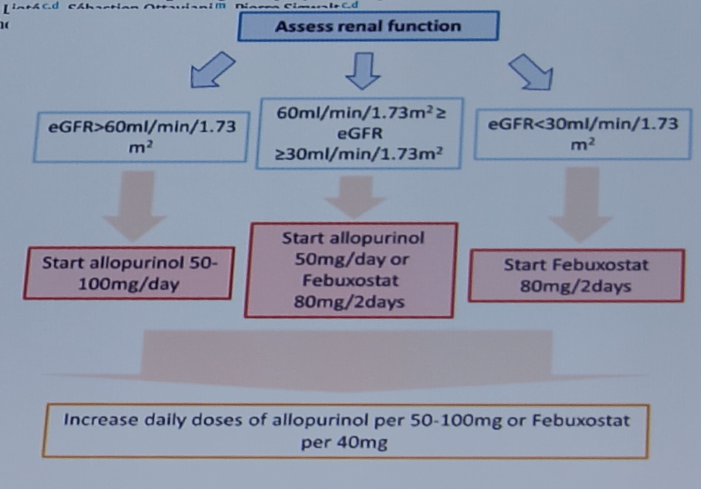

 
<h1>Goutte  </h1>
 
  
## Objectifs du traitement  
Goutte classique : 300 micromol/l 
Goutte tophacée sévère : 240 micromol/l 
## Traitement 
### Goutte et DFG normal
### Goutte et DFG < 30 
Traitement de crise => anakinra
Prophylaxie par colchicine 0.5mg 1 jour sur 2 
Traitement de fond par febuxostat 
 

 
<h1>Rhumatisme à PPC  </h1>
 

## Bilan étiologique
* **Avant 55 ans ou lorsque la maladie est sévère**, il faut chercher un facteur de risque :
  * ATCD de traumatisme articulaire ; en moyenne 20 ans après une méniscectomie
  * ATCDs familiaux / début très jeune : Mutation activatrice du gène HANK (très rares formes fam)
  * Hyperparathyroïdie
  * Hypomagnésémie
  * Hémochromatose

**On peu discuter quand même un dosage systématique calcémie et PTH** peut importe l'âge. 
## Traitement 
### Formes classiques
Colchicine 
AINS (à éviter chez les sujets âgés)
Corticothérapie orale (30–40 mg/j pendant 3–5 jours puis dégressif)
+/- Infiltration si monoarticulaire et cause septique éliminée
### Formes chroniques persistantes 
Colchicine au long cours 
+/- Prednisone faible dose au long cours 
+/- Tocilizumab 
(Anakinra ne fonctionne pas)

 
<h1> Rhumatisme à apathite </h1>
 

## Formes cliniques 
### Primitives
### Secondaires à : 
**Insuffisance rénale terminale avec hyperphosphorémie**
**Hypophosphatasie** : 
* Une hypophosphatasie doit être cherchée chez les patients présentant une maladie des calcifications tendineuses multiples et des déchaussages de dents ou des anomalies osseuses telles que rachitisme ou ostéomalacie

**Sclérodermie**
**Dermatomyosite** 
### Formes chroniques : 
**Normalement les crises aigues évoluent favorablement**
Mais parfois possibilité de **formes chroniques** => tendinite chronique ou épaississement du tendon → conflit antérosupérieur
### Milwaukee shoulder
Chez une patiente âgée → apparition progressive d’une tuméfaction douloureuse de l’épaule avec perte de fonction et épanchement articulaire hémorragique. => arthropathie destructrice (avec microcristaux d’hydroxy-apatite).
Une bilatéralité est retrouvée dans plus de la moitié des cas. 
Synonyme = épaule hémorragique sénile

## Prise en charge 
### Traitement des calcifications de l'épaule
1) **Médical seul (AINS)** => normalement évolution spontanément favorable
2) **Infiltration sous acromiale :**
   - en cas de forme rebelle
   - maximum 3 espacées de 10 jours
4) **3ème intention :**
    - **Ponction aspiration lavage + infiltration :**
      - si calcification type A ou B 
      - à accompagner d'une cure d'AINS ou colchicine. 
    - **Ondes de choc extracorporelles** (contre indiqué si anticoagulants)
5) **En dernier recours = Chirurgie :**
      - Formes invalidentes résistantes aux autres traitements depuis 1 an
      - Exérèse +/- résection du ligament acromiocoracoïdien et acromioplastie

---
**Voir aussi (imagerie)** : [Imagerie des cristaux](../AAA-Radiologie-ostéoarticulaire/Cristaux.md) · [Goutte](../AAA-Radiologie-ostéoarticulaire/Goutte.md) · [Chondrocalcinose](../AAA-Radiologie-ostéoarticulaire/Chondrocalcinose.md) · [Hydroxyapatite](../AAA-Radiologie-ostéoarticulaire/Hydroxyapatite.md) · [Hémochromatose](../AAA-Radiologie-ostéoarticulaire/Hemochromatose.md) · [Écho du rhumatisme à PPC](../AAA-Radiologie-ostéoarticulaire/Echographie/PPCecho.md.md)
