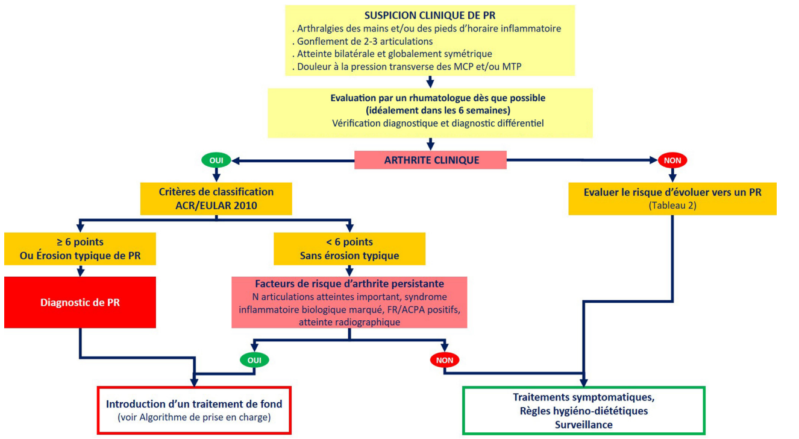

# Epidémiologie
# Diagnostic 
|     | Facteur rhumatoïde (FR) | Autoanticorps anti-protéines citrullinées (ACPA) |
| --- | --- | --- |
| Sensibilité dans la PR | 60–80 % | 60–75 % |
| Spécificité dans la PR | 65–85 % | 90–95 % |
| **Prévalence dans d’autres pathologies** |     |     |
| Maladie de Gougerot-Sjögren | 50–80 % | 10 % |
| Rhumatisme psoriasique | 10 % | 10 % |
| Lupus systémique | 20–30 % | 10 % |
| Sclérodermie systémique | 10–20 % | 10 % |
| Cryoglobulinémie mixte | > 90 % |     |

 

 

### Arthralgies cliniquement suspectes (tableau 2)
| Domaine | Élément permettant d'évaluer le risque d'évoluer vers une polyarthrite rhumatoïde |
| --- | --- |
| **Environnement** | Tabagisme, expositions professionnelles, parodontite, obésité, régime déséquilibré, bas niveau socioéconomique, sédentarité, stress, dépression, etc. |
| **Clinique** | Arthralgies cliniquement suspectes si **au moins 4 critères** parmi les 7 suivants :   • Évolution depuis moins d'un an   • Dérouillage matinal ≥ 1 heure   • Douleurs prédominant tôt le matin   • Douleurs localisées aux MCP   • Douleurs à la fermeture du poing   • Douleurs à la pression transverse des MCP   • Antécédent familial de PR chez les parents du 1er degré |
| **Biologie** | Nombre d'auto-anticorps positifs et leur taux :   • ACPA (anti-CCP2 ou CCP3)   • Facteur rhumatoïde (IgA ou IgM) |
| **Imagerie — Échographie** | • Synovites GS ≥ 2 ou PD+ sur les poignets, les MCP 1–5, les IPP 1–5 ou les MTP 2–5   • Ténosynovites PD+ des extenseurs ulnaires des carpes, des extenseurs communs ou des fléchisseurs des doigts |
#### Prise en charge : 
* Correction des facteurs de risque 
* Traitement symptomatique
* Surveillance tous les 3 à 12 mois pendant 1 à 3 ans (période la + à risque)

# Traitement 
## Traitement de crise 
## Traitement de fond
1) Méthotrexate : 
* posologie initiale d'au moins 15 mg/semaine
* A adapter en fonction du poids = environ 0,3 mg/kg
* Pouvant être optimisée jusqu'à 25 à 30 mg/semaine entre 1 et 3 mois en fonction de l'efficacité et de la tolérance.
* Associer à acide folique au moins 10mg par semaine

2) Alternative si CI ou intolérance au MTX :
     * Leflunomide à 20 mg/j (10mg dans certaines situations)
     * Sulfasalazine (2 à 3 g/j
5) 

## Objectifs du traitement de fond
A trois mois : Diminution > 1,2 points du DAS28
A 6 mois : 
* DAS28-VS < 2,6 = rémission
* entre 2,6 et 3,2 = faible activité
* Rémission booléenne =  NAD, NAG et CRP  : tous < ou égal à 1 ; EVA activité < ou égale à 2

**S'il n'y a pas d'amélioration dans les 3 mois suivant le début du traitement ou si l'objectif thérapeutique n'a pas été atteint à 6 mois, le traitement doit être ajusté.**

# Comorbidités

De quoi meurent les gens atteints de PR : 

1. cardiovasculaires
2. infections pulmonaires
3. autres affections pulmonaires (dont les PIDs)

Risque infectieux dans la PR : 

- Le risque infectieux est directement corrélé à l’activité de la PR
- Les corticoïdes augmentent le risque infectieux mais pas les biothérapies enfaite
# Suivi 

Tous les 1 à 3 mois tant que la maladie est active 

---
**Voir aussi (imagerie)** : [Imagerie de la polyarthrite rhumatoïde](../AAA-Radiologie-ostéoarticulaire/Polyarthrite-rhumatoïde.md)
