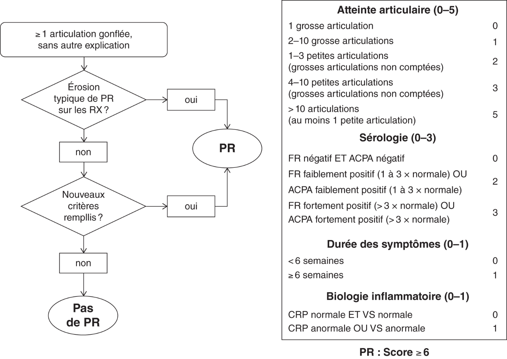

# Epidémiologie
# Diagnostic 
|     | Facteur rhumatoïde (FR) | Autoanticorps anti-protéines citrullinées (ACPA) |
| --- | --- | --- |
| Sensibilité dans la PR | 60–80 % | 60–75 % |
| Spécificité dans la PR | 65–85 % | 90–95 % |
| **Prévalence dans d’autres pathologies** |     |     |
| Maladie de Gougerot-Sjögren | 50–80 % | 10 % |
| Rhumatisme psoriasique | 10 % | 10 % |
| Lupus systémique | 20–30 % | 10 % |
| Sclérodermie systémique | 10–20 % | 10 % |
| Cryoglobulinémie mixte | > 90 % |     |

 

 

# Comorbidités

De quoi meurent les gens atteints de PR : 

1. cardiovasculaires
2. infections pulmonaires
3. autres affections pulmonaires (dont les PIDs)

Risque infectieux dans la PR : 

- Le risque infectieux est directement corrélé à l’activité de la PR
- Les corticoïdes augmentent le risque infectieux mais pas les biothérapies enfaite

---
**Voir aussi (imagerie)** : [Imagerie de la polyarthrite rhumatoïde](../AAA-Radiologie-ostéoarticulaire/Polyarthrite-rhumatoïde.md)
