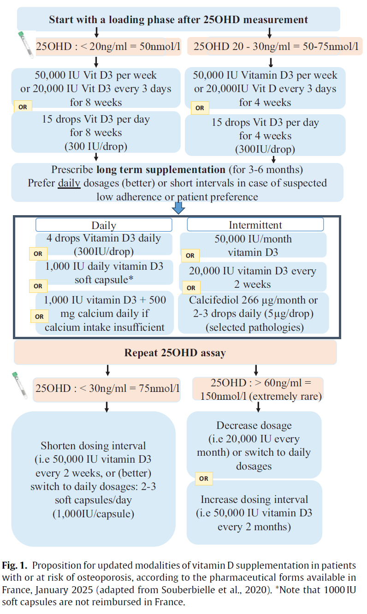

# **Vitamine D**

## 1) Population générale

Supplémentation sans dosage.

## 2) Patients à risque

Supplémentation après dosage de la vitamine D.

### Personnes concernées

- Sujets ostéoporotiques ou à risque d'ostéoporose
- Sujets âgés à risque de chute
- Iatrogène :
  - Corticoïdes au long cours
  - Traitements anti-épileptiques
  - Anti-aromatases
  - Analogues de la GnRH
- Maladies endocriniennes et dermatologiques : hyperparathyroïdie…
- Malabsorption, maldigestion, cholestase, insuffisance hépatique
- Maladie cœliaque, mucoviscidose, pancréatite chronique, cholangites, chirurgie bariatrique
- Maladie rénale chronique, syndrome néphrotique
- Anorexie mentale

## 3) Quand doser la vitamine D en rhumatologie ?

Recommandé pour tout sujet à risque d'ostéoporose ou ostéoporotique par le GRIO, mais remboursé en France pour :

- Personne âgée avec chutes répétées (noter sur l'ordonnance : « Évaluation et prise en charge des personnes âgées sujettes aux chutes répétées »)
- Traitement préconisant une mesure de la vitamine D (ex. bisphosphonates)
- Suspicion de rachitisme
- Suspicion d'ostéomalacie (fatigue musculaire, douleurs osseuses)

## 4) Tableau de conversion

| Unités | Carence sévère | Insuffisance | Concentration optimale en population générale | Cible chez patients à risque | Ne pas supplémenter au-delà de | Seuil toxique |
|---|---|---|---|---|---|---|
| ng/mL | < 10-12 | 10-20 | 20-50 | 30-60 | 60 | 150 |
| nmol/L | < 30 | 30-50 | 50-125 | 75-150 | 150 | 375 |
