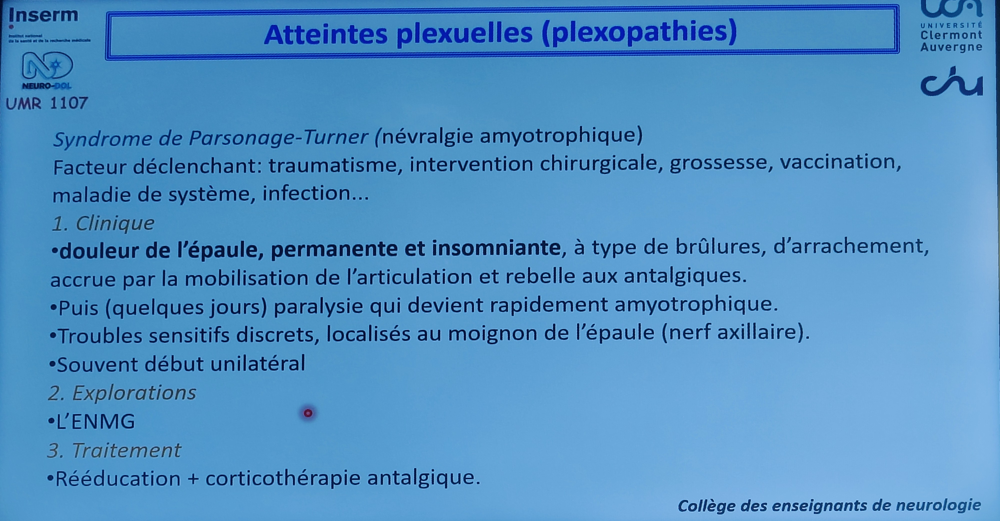

# Épaule

**Syndrome de personnage Turner :**

Y penser devant douleur épaule aiguë aux urgences ! 

Traitement = corticothérapie 1mg/Kg, rééducation 
 

---
**Voir aussi (imagerie)** : [Imagerie de l’épaule](../AAA-Radiologie-ostéoarticulaire/Épaule.md) · [Épaule IRM](../AAA-Radiologie-ostéoarticulaire/Epaule-IRM.md) · [Protocole échographie épaule](../AAA-Radiologie-ostéoarticulaire/Echographie/Epauleecho.md) · [Parsonage-Turner (imagerie)](../AAA-Radiologie-ostéoarticulaire/Épaule/Syndrome-de-parsonage-et-turner.md)
