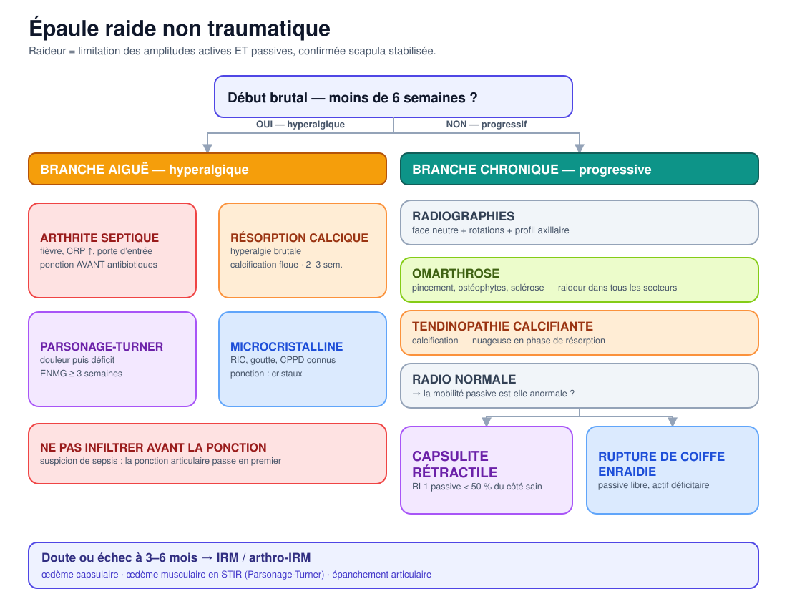

# **Épaule raide non traumatique — arbre décisionnel**

**Définition opérationnelle.** Raideur = limitation des amplitudes **actives ET passives**, confirmée en mobilisant l'articulation gléno-humérale **scapula stabilisée**. Deux pièges de vocabulaire :
- limitation **uniquement active** = déficit moteur (rupture de coiffe, atteinte neurologique), pas une raideur ;
- limitation **uniquement par la douleur** (amplitude passive complète après relâchement) = épaule « pseudo-raide », pas une raideur capsulaire.

---

## Algorithme

*Figure 1. Arbre décisionnel complet. Ouvrir l'image dans un nouvel onglet pour la voir en pleine résolution — [fichier SVG](.attachments/algorithme-epaule-raide-portrait.svg).*

## Détail des branches (version texte)

*La figure résume l'arbre ; les lignes qui suivent détaillent chaque étape.*

1. **Installation brutale ou progressive ?**
   - → **Brutale** : étape 2 (branche aiguë).
   - → **Progressive** : étape 3 (branche chronique).
2. **Branche aiguë — quel tableau domine ?**
   - **Fièvre / frissons / CRP élevée / porte d'entrée** → arthrite septique → **ponction articulaire avant toute antibiothérapie**.
   - **Douleur brutale hyperalgique à recrudescence nocturne, sans fièvre, calcification sur la radio** → résorption calcique (épaule aiguë hyperalgique).
   - **Douleur intense 1–2 semaines puis déficit moteur / amyotrophie** → syndrome de Parsonage-Turner.
   - **Dérouillage matinal prolongé, contexte de RIC ou de goutte/CPPD connu** → poussée inflammatoire ou microcristalline.
   - **Aucun de ces tableaux, douleur reproduite à l'effort, pas de vraie raideur (RL1 conservée)** → poussée sur tendinobursite dégénérative (1re cause de douleur aiguë, mais ce n'est pas une épaule raide).
3. **Branche chronique — radiographies de l'épaule**
   - **Signes d'omarthrose** (ostéophyte principalement) → **omarthrose** : raideur dans **tous** les secteurs, craquements.
   - **Calcification** → tendinopathie calcifiante chronique (à distinguer d'une enthésopathie calcique dégénérative, qui ne se résorbe pas).
   - **Autre anomalie** → fracture/luxation méconnue, chondromatose, lésion osseuse : avis spécialisé.
   - **Radio normale** → étape 4.
4. **Radio normale — comparer mobilité passive et active, scapula bloquée**
   - **Perte de la rotation latérale coude au corps (RL1) et/ou de l'élévation antérieure scapula bloquée** → **capsulite rétractile**. La RL1 est le secteur le plus précocement et le plus sévèrement touché.
   - **Mobilité passive complète, mobilité active déficitaire** → **rupture de coiffe** (forme « enraidie » si la douleur limite aussi le passif) 
5. **Doute persistant / échec à 3–6 mois / drapeau rouge initialement négligé** → IRM 

---

## Branche aiguë : comment les différencier

| **Critère** | **Résorption calcique** | **Arthrite septique** | **Parsonage-Turner** |
|---|---|---|---|
| **Terrain** | 30–50 ans, femme ×2 | Immunodépression, porte d'entrée | Sujet sain, épisode viral ou vaccinal récent |
| **Début** | Brutal, sans facteur déclenchant | 1–3 jours, croissant | Douleur 1–2 semaines, puis déficit |
| **Douleur** | Hyperalgique, insomniante | Inflammatoire, insomnie | Continue et intense, puis mécanique |
| **Mobilité** | Active **et passive** bloquées **par la douleur** | Toute mobilisation impossible | Passive libre, **active déficitaire** |
| **Fièvre** | Non | Oui, souvent | Non |
| **Biologie** | CRP normale ou limite | Leucocytes ↑, CRP/PCT ↑ (normales possibles si immunodéprimé) | Normale |
| **Imagerie** | Radio : calcification **floue** ; écho : dépôt **sans cône d'ombre**, hyperhémie périphérique | Radio normale au début (érosion > 10–14 j) | ENMG ≥ 3 semaines ; IRM : œdème STIR des muscles dénervés |
| **Geste clé** | Aucun | **Ponction articulaire** avant antibiotiques | Aucun |

**Variante : arthrite microcristalline ou poussée de rhumatisme inflammatoire.** Même tableau qu'une arthrite septique, avec dérouillage matinal prolongé et maladie connue (goutte, CPPD, RIC) : ponction avec **recherche de cristaux** (urate, pyrophosphate), chondrocalcinose sur la radio. La culture reste négative.

**Divergences / incertitudes signalées**
- Sur la ponction dans le sepsis d'épaule, il n'existe **pas d'approche standardisée** : la cellularité synoviale est sous-utilisée et peut être plus basse qu'attendu selon le délai diagnostic (revue systématique 2022, 31 études).
- Le seuil de cellularité > 50 000/mm³ est un repère classique, pas un critère validé pour l'épaule.
- La résorption calcique est **la** cause typique de l'épaule aiguë hyperalgique, mais environ 25 % des tendinopathies calcifiantes ont une rupture de coiffe associée : une calcification vue sur la radio n'exclut pas une lésion tendineuse.

---

## Branche chronique : capsulite ou rupture de coiffe ?

| **Critère** | **Capsulite rétractile (épaule gelée)** | **Rupture de coiffe enraidie** |
|---|---|---|
| **Début** | Insidieux, sans traumatisme ni cause évidente | Souvent progressive, parfois après un épisode douloureux aigu ; sujet plus âgé |
| **Douleur** | Nocturne, réveils en décubitus du côté atteint, mal localisée | Plutôt à l'effort, à l'élévation ; douleur de l'épaule « faible » |
| **Mobilité passive** | **Limitée dans plusieurs plans**, à commencer par la **RL1** | **Complète** (ou limitée seulement par la douleur) |
| **Mobilité active** | Limitée (les deux le sont) | **Déficitaire**, souvent plus que la passive |
| **Force** | Conservée | Déficitaire : Jobe, Patte, Gerber/lift-off, belly-press, drop sign |
| **Radio** | Normale (interligne gléno-huméral **normal** ; ostéopénie de la tête humérale possible) | Normale ou remaniements dégénératifs, espace sous-acromial ↓ si rupture massive |
| **Échographie** | Épaississement du ligament coraco-huméral, hyperhémie du rotator interval | Rupture tendineuse, rétraction, amyotrophie graisseuse |
| **Terrain** | 40–60 ans, diabète (10–30 % des diabétiques), dysthyroïdie, post-opératoire, immobilisation | Âge avancé, épaule dégénérative |

**Repères chiffrés utiles (non consensuels).** ISAKOS définit la restriction globale par une flexion < 100°, une rotation externe < 10° et une rotation interne < L5. L'essai FROST retient une **rotation latérale passive < 50 % du côté controlatéral** avec radiographies normales. Il n'existe pas de critère international unique.

---

## Capsulite : primaire ou secondaire ?

- **Primaire** : aucune cause ; rechercher quand même un **diabète** (glycémie à jeun + HbA1c) et une **dysthyroïdie** si point d'appel — ces comorbidités sont associées à des formes plus sévères et plus résistantes.
- **Secondaire** : post-traumatique, post-chirurgicale, immobilisation, hémiplégie, pathologie cardiaque ou pulmonaire, diabète, dysthyroïdie.
- **Évolution** : douleur prédominante (2–6 mois) → douleur + raideur (4–12 mois) → dérouillage (6–26 mois). La raideur qui **s'aggrave à chaque consultation** est un argument pour la capsulite, contrairement à une tendinopathie.
- **Bilan minimum** : aucune imagerie supplémentaire si le tableau est typique et la radio normale ; HbA1c, TSH si suspicion.

---

## Pièges à ne pas manquer

- **Luxation postérieure méconnue** : perte de la rotation externe, douleur modérée, radio de face parfois normale → **incidence axillaire ou de Grashey**. Terrain : crise d'épilepsie, électrocution, choc antérieur.
- **Arthrite septique à germes à croissance lente** (mycobactéries, Brucella) : tableau subaigu, biologie peu perturbée, délai diagnostique = destructions articulaires.
- **Omarthrose excentrée (coiffe incontinente)** : espace sous-acromial < 7 mm, pseudoparalysie, hypotrophie des fosses sus- et sous-épineuses ; c'est la forme la plus fréquente et la plus symptomatique.
- **Parsonage-Turner bilatéral** (possible, avec parfois une atteinte controlatérale uniquement visible à l'ENMG) et **formes douloureuses sans déficit initial** : l'amyotrophie n'apparaît qu'en quelques semaines, souvent dans le mois.
- **Épaule neurologique** : paralysie du serratus anterior, syndrome canalaire, névralgie cervico-brachiale C5/C6 — l'examen neurologique fait partie de l'examen de toute épaule raide.
- **Causes non articulaires** : PPR/Horton (bilatéral, > 50 ans), tumeur de l'apex (Pancoast), pathologie cardio-pulmonaire, douleur projetée hépatobiliaire.
- **Imagerie à ne pas prescrire d'emblée** : l'imagerie ne se conçoit qu'après une démarche clinique qui a formulé une hypothèse — c'est la position de la HAS, et elle évite les examens « normaux » qui ne font qu'ajouter de l'incertitude.

---

## Références

1. HAS. *Conduite diagnostique devant une épaule douloureuse non traumatique de l'adulte* — fiche et arbre décisionnel, RBP validée le 31 août 2023, mise à jour février 2024. [Fiche (PDF)](https://has-sante.fr/upload/docs/application/pdf/2023-08/fiche_conduite_diagnostique_devant_une_epaule_douloureuse_non_traumatique_de_ladulte.pdf) · [Arbre décisionnel (PDF)](https://www.has-sante.fr/upload/docs/application/pdf/2023-08/arbre_decisionnel_diagnostic_douleur_epaule_persistante_v3-210723_2023-08-30_15-10-23_66.pdf) · [Page de la recommandation](https://www.has-sante.fr/jcms/p_3459565/fr/conduite-diagnostique-devant-une-epaule-douloureuse-non-traumatique-de-l-adulte-et-prise-en-charge-des-tendinopathies-de-la-coiffe-des-rotateurs)
2. ISAKOS Upper Extremity Committee / revue de synthèse. *Clinical Guidelines in the Management of Frozen Shoulder: An Update!* Indian J Orthop, 2021. [PMC8046676](https://pmc.ncbi.nlm.nih.gov/articles/PMC8046676/)
3. Kim MS et al. *Diagnosis and treatment of calcific tendinitis of the shoulder.* Clin Shoulder Elb, 2020. [PMC7726362](https://pmc.ncbi.nlm.nih.gov/articles/PMC7726362/)
4. *Imaging of calcific tendinopathy: natural history, migration patterns, pitfalls, and management: a review.* 2024. [PMC11135804](https://pmc.ncbi.nlm.nih.gov/articles/PMC11135804/)
5. Feinberg JH, Radecki J. *Parsonage-Turner Syndrome.* HSS J, 2010. [PMC2926354](https://pmc.ncbi.nlm.nih.gov/articles/PMC2926354/)
6. Norbury JW, van Alfen N et al. *How to Know it When You See It: Diagnosing Neuralgic Amyotrophy (Parsonage-Turner Syndrome).* Practical Neurology, 2015.
7. Salazar LM et al. *Joint aspiration and serum markers — do they matter in the diagnosis of native shoulder sepsis? A systematic review.* BMC Musculoskelet Disord, 2022. [PMC9118805](https://pmc.ncbi.nlm.nih.gov/articles/PMC9118805/)
8. Moriclet T, Forthomme B, Mahieu X, Kaux JF. *Omarthrose : épidémiologie, classification et approche clinique.* 2021. [PDF](https://orbi.uliege.be/bitstream/2268/261990/1/main-2.pdf)
9. AAOS. *Management of Glenohumeral Joint Osteoarthritis — Evidence-Based Clinical Practice Guideline*, 2020. [PDF](https://www.aaos.org/globalassets/quality-and-practice-resources/glenohumeral/GJO-CPG.pdf)

---

**Voir aussi** : [Épaule](Épaule%2014645f5988be8016ac96de4a1303f885.md) · [Imagerie de l'épaule](../AAA-Radiologie-ostéoarticulaire/Épaule.md) · [Épaule IRM](../AAA-Radiologie-ostéoarticulaire/Epaule-IRM.md) · [Protocole échographie épaule](../AAA-Radiologie-ostéoarticulaire/Echographie/Epauleecho.md)
