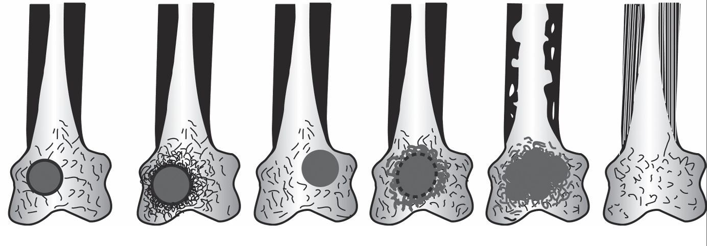
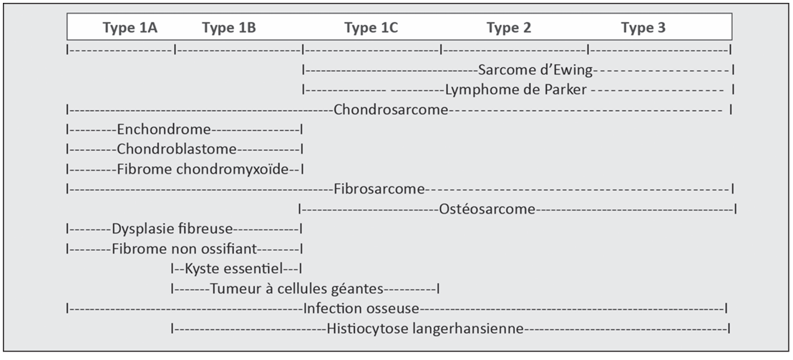

 
<h1>Plan d'interprétation d'une lésion osseuse unique radiotransparente </h1>
 

## 4 signes d'agressivité
* Limites floues, mitées, perméatives, = types 1C, 2 et 3 de la classification de Lodwick.
* Réaction périostée plurilamellaire, spiculée en feu d'herbe
* Soufflure corticale avec rupture / Destruction corticale
* Envahissement des tissus voisons
## 3 signes d'activité 
* Réaction périostée unilamellaire
* Encoches endostées
* Soufflure corticale (sans destruction)
## Plan = Rechercher des signes d'activité et d'agressivité dans ces 4 catégories
### 1) Limites
Est-ce que je peux savoir où la lésion s'arrête exactement sur tout son contour ou pas ? 
### 2) Corticale et réaction périostée :
  * Hyperostose :
    * Epaississement de la corticale de l'os
    * Epaississement + Encoches endostées
* Réaction périostée lamellaire :
  * Unique
  * Multiple
  * En feu d'herbe
* Soufflure corticale
* Rupture corticale

### 3) Condensation
### 4) Envahissement des tissus voisons
* Tissus mous
* Articulations

## Prise de décision : 
### Si au moins 1 signe d'activité ou d'agressivité = biopsie !!!
Sauf si arguments francs pour une cause infectieuse évidente bien sûr ou autre site + accessible. 
### Si aucun signe d'activité ou d'agressivité + clinique, ATCDs et biologie normale = surveillance 

## 1) Limites 
  **Classification de Lodwick adaptée par JD Laredo**
 
| Type | Aspect radiologique | Signification / diagnostics évoqués | Activité |
| --- | --- | --- | --- |
| **1A1** | Lacune unique (géographique) à **limites nettes**, condensées, cerclées d'un liseré de condensation net sur ses 2 versants | Lésions quiescentes fibreuses (dysplasie fibreuse, fibrome non ossifian), kystes et lipomes intra-osseux | Quiescente |
| **1A2** | Lacune unique (géographique) à **limites nettes**, entourée d'une condensation progressivement dégressive vers l'os normal | Lacune **inflammatoire** : Pseudo-tumeurs (ostéite infectieuse = abcès de Brodie, ostéite aseptique, histiocytose langheransienne), métastases, hémopathies (myélome, lymphome), tumeurs primitives bénignes (ostéome ostéoïde, ostéoblastome, chondroblastome) tumeurs primitives malignes (ostéosarcome) | Quiescente |
| **1B** | Lacune unique (géographique) à **limites nettes**, non condensées | Processus quiescent sans réaction de l'os environnant (ex. kyste essentiel) | Quiescente |
| **1C** | Lacune unique (géographique) à **limites floues**, progressives, avec zone de transition avec l'os normal | Lésion infiltrante tumorale ou infectieuse | Active |
| **2** | Lacunes multiples confluentes à **limites floues**, aspect d'os mité ("moth-eaten") en os spongieux et cortical | Processus agressif (infiltration) | Active |
| **3** | Cortical feuilletée ("perméative") par augmentation de calibre des canaux de Havers | Hypervascularisation ou infiltration lésionnelle | Active |

 

## 2) Corticale et réaction périostée 
### Hyperostose :
Si simple épaississement de la corticale de l'os avec **respect de l'endoste** alors c'est un processus plutôt quiescent. 

Si épaississement associé à des **encoches endostées** ou un **élargissement de la cavité médullaire** : **Signe d'agressivité** ou du moins d'un processus "lentement actif"
### Réaction périostée lamellaire : 
Toutes les réaction périostées lamellaires témoignent d'un processsus récent (actif). 
L'important pour l'agressivité c'est le caractère uni ou plurilamellaire. 
#### Unilamellaire = actif mais principalement bénin :
**Pseudotumeurs :** 
* Ostéomyélite aigue
* Granulome éosinophile
* Fissure osseuse
* Infarctus osseux
  
**Tumeurs primitives bénignes :** Ostéome-ostéoïde
#### Plurilamellaires = agressif : 
#### Perpendiculaires à la corticale en "feu d'herbe" = agressif : 
Encore plus si la lésion osseuse est très peu visible et qu'il n'y a pas de rupture corticale  => aspect **tumeur in / tumeur out** c'est à dire tellement agressif et infiltratif que n'a pas le temps de détruire l'os. 
=> l'image la plus agressive c'est celle qu'on ne voit pas ! 

**Tumeurs primitives :** 
* Sarcomes d'Ewing
* Certains ostéosarcomes.
  
**Hémopathies** : Lymphomes
### Soufflure corticale : 
Amincissement = agressif 
Amincissement + destruction = très agressif

**Pseudotumeurs :** 
* Infections : tuberculose
* Oses : angiomatose, angiome
* Scinti + : dysplasie fibreuse des os
* Tumeurs brunes (hyperparathyroïdie)
  
**Métastases :** Rein, thyroïde
**Hémopathies** : myélome
**Tumeurs primitives :** 
* TCG
* Ostéoblastome
* Chrondrome
* Chondrosarcome

### Rupture corticale : 
**Réflexe numéro 1 = Infections**

**+/- Tumeurs primitives agressives**
## 3) Condensation
## 4) Envahissement des tissus voisins

* Tissus mous
* Articulations

 
<h1>Principales images lacunaires uniques en fonction de leur localisation </h1>
 

## Lacunes épiphysaires : 
* **Pseudo-tumeurs :**

**Géodes d'arthropathie** : arthrose, CCA => regarder l'articulation ! 
**Kyste mucoïde épiphysaire à clapet ostéochondral :** kyste mucoïde ou géode dans l'épiphyse contenant du liquide synovial qui ne peut pas sortir a cause du clapet. => Rechercher la solution de continuité de la corticale. 
**Erosions**
**Infections** : Surtout avant 10 ans

* **Métastases :**
Pas vraiment ici : Leur centre géométrique est souvent métaphysaire puis extension  à l’épiphyse

* **Hémopathies :**

**Myélome :** 
**Lymphome :** Surtout au genou  

* **Tumeurs osseuses primitives bénignes :**

**Chondroblastome :** 
Tumeur osseuse bénigne rare, présente dans les extrémités arrondies (épiphyse - centres de croissance secondaires) des os longs des bras et des jambes. Il représente environ 1% de toutes les tumeurs osseuses bénignes et survient généralement chez les adolescents et les jeunes adultes. 

Aspect : 
* Centre géographique excentré
* lacune unique à bords nets
*  Niveaux liquidiens en IRM.
*  Sans liseré d'ostéocondensation périphérique.
* Oedème de l'os limitrophe (condensation périphérique à bord flous). 

**Tumeurs à cellules géantes :** Métaphysaires à extension épiphysaire. 

**Ostéoblastome :** _! mais extrêmement rare à cette localisation (touche surtout vertèbres arc postérieur et diaphyse/metaphyse)!_ Tumeur bégnine due à la prolifération des ostéoblastes. Touche les adultes jeunes < 30 ans. 

* **Tumeurs osseuses primitives malignes :**

**Chondrosarcome à cellules claires :** Extrêmement rare ! 2% des chondroscarcomes.  
Lésions ostéolytiques bien délimitées, souvent localisées à l'épi-métaphyse du fémur ou de l'humérus proximal.
**Ostéosarcome chondroblastique :**
Sous-type rare et agressif de cancer des os caractérisé par des cellules tumorales malignes qui fabriquent à la fois du tissu osseux et une matrice semblable à du cartilage (tissu chondroïde). Il touche préférentiellement les adolescents et les jeunes adultes au niveau des os longs. 
  
## Lacunes métaphysaires : 
* **Pseudo-tumeurs :**

**Ostéomyélite**
**Abcès de Brodie**

* **Métastases :** Leur centre géométrique est souvent métaphysaire puis extension  à l’épiphyse

* **Hémopathies :**
**Myélome :** 

* **Tumeurs osseuses primitives bénignes :**

**Kyste osseux essentiel :** Tumeur osseuse bénigne la plus fréquente (90 % des cas dans les deux premières décennies de la vie). Il s’agit d’une dystrophie osseuse kystique uni- ou pluriloculaire, localisée le plus souvent sur la métaphyse/épiphyse des os longs (humérus dans plus 50 % des cas, calcanéum dans 3 % des cas). 

Aspect : 
* Lacune diaphysaire ou métaphysaire centrée
* Pas de matrice interne (ou fragments des bords qui se sont fracturés et qui sont à l'intérieur)
* Bords nets sans condensation périphérique
* Pôle inférieur en "fond de coquetier"
* Encoches endostées
* Soufflures et ruptures corticales. 

**Fibrome non ossifiant :** Le fibrome non ossifiant, ou « cortical defect », est une lésion corticale, rencontrée chez les enfants et les adultes jeunes. Elle régresse en se calcifiant avec l’âge.

Aspect : 
* Lacune collée à un endoste donc excentrée (mais il faut deux incidences pour le voir)
* Polylobée
* Limitée par de la condensation à bords nets sur ses deux versants = cerclée 

**Exostose (ou ostéochondrome) :** Tumeur sessile ou pédiculée réalisant une image d’addition, naît perpendiculairement à la métaphyse et se dirige vers la diaphyse. Elle est dotée d’une coiffe cartilagineuse parfois calcifiée. Elle est asymptomatique. La survenue de douleurs inflammatoires doit faire craindre une dégénérescence sarcomateuse qui ne se produit guère que dans les formes multiples.

**Ostéome ostéoïde :**  Touche en particulier les enfants et les jeunes adultes. Clarté ronde, contenant un _nidus_ central sclérotique dense (la lésion caractéristique de ce type de tumeur) entouré d'os sclérotique. Le nidus est rarement plus grand que 1,5 cm. il est la cause de douleurs nocturnes, typiquement bien calmées par les AINS, notamment l’aspirine.

**Enchondrome (ou chondrome):** Tumeur à différenciation cartilagineuse, le plus souvent dans les os distaux, réalisant une ostéolyse bien limitée parsemée de calcifications annulaires. 

**Fibrome chondromyxoïde** 

**Tumeurs à cellules géantes** :  
Tumeurs osseuses bénignes qui peuvent se développer de manière agressive et détruire les os proches d'une articulation. 

Aspect radiologique : 
* Le centre est exactement sur le cartilage de croissance
* Excentrées
* Pas de matrice interne
* Bords nets sans condensation périphérique
* Os spongieux adjacent intègre
* Destruction de la corticale osseuse et reconstruction d'une coque périostée continue.

**Dysplasie fibreuse :** 
Tumeur métaphysodiaphysaire, touchant en premier lieu les os longs (le col fémoral ou les côtes ++) ; elle est en général de découverte fortuite.

Présentation radiologique : 
* Image centrale
* Très allongée (normalement pas ronde ou ovale )
* Contient un « verre dépoli »
* Liseré de condensation périphérique
* Scinti +

L’atteinte osseuse peut être monostotique ou polyostotique
Elle peut faire partie du syndrome de McCune-Albright avec taches cutanées « café au lait » et manifestations endocriniennes (notamment diabète phosphaté par sécrétion inappropriée de FGF-23). Elle peut dégénérer dans de très rares cas.

**ABC**

* **Tumeurs osseuses primitives malignes :**

**Chondrosarcome:**
Groupe hétérogène de tumeurs cartilagineuses malignes qui touchent le plus souvent les patients âgés. Ils peuvent apparaître de novo ou à la suite d'une néoplasie cartilagineuse bénigne préexistante. 

Présentation radiologique : la clé pour les reconnaître est l'élargissement de la cavité médullaire ou les encoches endostées car les autres signes d'activité sont peu présents (lésions d'évolution lente) 

**Ostéosarcome** 

## Lacunes diaphysaires  : 
* **Pseudo-tumeurs :**

**Ostéomyélite infectieuse :** Lacune diaphysaire excentrée, matrice interne hyper T1 spontané, bords nets sans condensation périphérique, oedème osseux périphérique, rupture corticale et masse des parties molle. 

**Ostéomyélite aseptique :** Rare dans le SAPHO, bcp plus fréquent dans l'ostéomyélite aseptique multifocale de l'enfant. 

**Histiocytose liée à l'X = langerhansienne :** Maladie systémique rare caractérisée par l'accumulation (généralement organisée en **granulomes à éosinophiles**) de macrophages présentant les caractéristiques des cellules de Langerhans dans divers tissus. 

Présentation radiologique : 
* Lacune diaphysaire excentrée
* Bords nets sans condensation périphérique
* Oedème osseux péri lésionnel
* Réaction périostée unilamellaire
* Encoches endostées et amincissement cortical. 

**Infarctus osseux** Scinti + 

**Fissures longitudinales :**

* **Hémopathies :**

  
**Myélome**

**Plasmocytome solitaire**

**Lymphome** 

* **Tumeurs osseuses primitives bénignes :**

**Chondrome**

**Hémangiome**

**Hémangiomendothéliome épithéloïde**

**Kyste osseux essentiel**

**Ostéome ostéoïde**

* **Tumeurs osseuses primitives malignes :**

**Chondrosarcome**

**Angiosarcome**

 
<h1>Plan d'interprétation d'une lésion osseuse unique condensante </h1>
 

## Condensation bénigne au scanner :

- parfaitement homogène, très dense (autant que la corticale osseuse)

## Condensation suspecte :**

- Densité inférieure à celle de la corticale
- Densité inférieure à 980 UH
- Bords flous mal délimités
- Irrégularités de la corticale
- T2 DIXON permet de voir la graisse en hypersignal

 
<h1>Principales images condensantes uniques
</h1>
 

 
<h1>Remplacement médullaire </h1>
 

## Aspect en IRM rachidienne  :

Égalisation du signal entre les vertèbres et les disques (alors que normalement les disques sont moins intenses que la moelle osseuse), voire hyposignal médullaire comparé aux disques. 
=> Surtout avec l'âge 80% graisse dans la moelle donc hyperintense normalement

## Causes de remplacement médullaire diffus :
- Néoplasies
  - Myélome et lymphomes (et n'épargnent pas l'épiphyse fémorale)
  - LLC, LMC, LAM, LAL
- Surcharge métabolique : 
  - Maladie de Gaucher (en glucosylcéramide = maladie génétique rare)
  - Amylose, ostéopétrose
- Sarcoïdose (rarement remplacement diffus)
- Miliaire tuberculeuse
- Hyperplasie médullaire (pas vrai remplacement médullaire) : 
  - Rebond après certaines chimiothérapies
  - Anémies régénératives
  - Personnes vivant en altitude (hypoxie)
  - ...

 
<h1>Angiomes </h1>
 

## Angiomes simples  :

- Aspect grillagé, avec travées osseuses visibles en T1
- Bords nets

## Petit angiome :

- A proximité des veines au milieu de la vertèbre
- Composante graisseuse

## Angiome agressif :

- Interruption corticale
- Augmentation rapide de la taille
- Oedème périphérique
