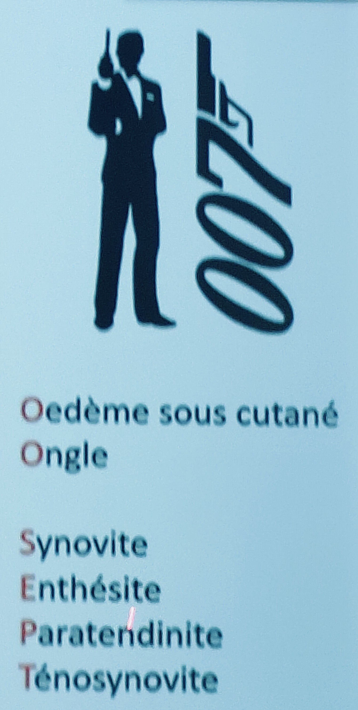

# **Rhumatisme psoriasique**

Moyen mnémotechnique pour les anomalies des dactylites du rhum pso :

 

[Imagerie dans le pré rhumatisme psoriasique ](Imagerieprerhumpso.md)

Traitements :

- Axial = biothérapies
- Périph = cs dmards puis biothérapies si inefficace
- anti il 23 marche le mieux, 12/23, et aussi  il-17 et anti TNF